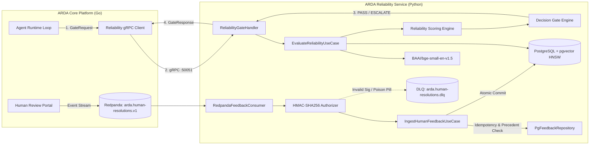

# ARDA Reliability Service

**The Evidence-Based Reliability & Governance Gate for Autonomous AI Agents.**

The **ARDA Reliability Service** evaluates proposed AI agent actions against historical human-adjudicated precedents to determine whether an agent's decision can safely proceed autonomously or must be escalated for human review.

It is an independent Python microservice within the broader **ARDA platform** (`github.com/aswinsreeraj/arda`), exposing high-performance gRPC interfaces to the Go Agent Runtime, managing dense vector storage in PostgreSQL with `pgvector`, and streaming human feedback continuously through Redpanda (Kafka).

---

## Why This Exists: The Problem with Autonomous LLMs

Large Language Models (LLMs) can generate fluent, persuasive rationales without necessarily producing correct or policy-compliant actions. In consequential operations—such as financial transaction disputes, customer onboarding, department routing, and privileged IT operations—relying purely on LLM internal confidence creates unacceptable risk.

ARDA solves this through **non-parametric, exemplar-based reliability governance**:
1. An autonomous agent proposes an action or decision on an incoming case narrative.
2. The Reliability Service embeds the factual narrative into latent vector space.
3. It retrieves the nearest historical human-adjudicated precedents from PostgreSQL using `pgvector`.
4. It computes a decomposed reliability score across **Agreement**, **Evidence Density**, and **Precedent Coverage**.
5. It applies a 6-stage operational gate policy.
6. It returns `GATE_OUTCOME_PASS` (autonomous execution allowed) or `GATE_OUTCOME_REVIEW_REQUIRED` (`ESCALATE`).
7. If escalated, the ARDA Go Agent Runtime **fails closed**, halting autonomous execution and routing the case to a human supervisor.
8. When the human supervisor resolves the case, the decision is signed with **HMAC-SHA256**, streamed over **Redpanda**, and ingested into the vector database—**closing the active learning loop in real time without model retraining**.

---

## Architectural Workflow



---

## Core Capabilities & Technical Pillars

### 1. Multi-Tenant & Domain-Agnostic Scoping
The platform is designed to govern arbitrary agents across any tenant:
- **Strict Data Isolation**: Every reference example, feedback event, and retrieval query is strictly scoped and indexed by `(tenant_id, agent_id)`. Tenant A's customer onboarding agent never sees Tenant B's financial dispute precedents.
- **Configurable Decision Schemas**: Supports binary adjudication (`APPROVE` / `REJECT`), multi-class department routing (`BILLING`, `LEGAL`, `KYC`, `TECH_SUPPORT`), and custom action schemas via `ScoringConfig(allowed_decisions=...)`.
- **Dynamic Per-Agent Risk Thresholds**: The caller specifies `reliability_threshold` per agent in each gRPC request, allowing high-risk wire transfers to require `0.85` while low-risk ticket routing requires `0.45`.

### 2. High-Performance Vector Retrieval (pgvector + HNSW)
- **Model**: `BAAI/bge-small-en-v1.5` generating 384-dimensional unit L2-normalized embeddings.
- **Asymmetric Prefixing**: Queries use `"Represent this sentence for searching relevant passages: "`, while stored precedents use native passage narratives.
- **Zero Target Leakage**: Only the natural language case narrative is embedded. Proposed decisions, reference labels, and reviewer rationales are strictly excluded from embedding inputs to prevent target leakage.
- **HNSW Indexing**: Traverses cosine distance (`<=>`) in $O(\log N)$ time:
  - Configuration: `m = 16`, `ef_construction = 64`, `ef_search = 64`.
  - Empirical Performance: **100.0% Recall@K** across all evaluated query modes with **sub-millisecond latency (0.55 ms median)**.
- **Pluggable Architecture**: `EmbeddingProviderPort` allows swapping local SentenceTransformers for external embedding APIs (e.g. OpenAI, Cohere, Voyage AI).

### 3. Decomposed Multiplicative Reliability Scoring
Rather than relying on unweighted averages, the scoring engine calculates:
$$R = \text{Agreement} \times \text{Density} \times \text{Coverage}$$

- **Agreement ($A \in [0.0, 1.0]$)**: Similarity-weighted consensus of retrieved precedents with the agent's proposed action:
  $$A = \frac{\sum_{i \in \text{Matching}} \max(0, s_i)}{\sum_{i=1}^K \max(0, s_i)}$$
- **Density ($D \in [0.0, 1.0]$)**: Measures cluster proximity above a relevance floor ($s_{\min} = 0.70$), blending the top precedent ($\alpha=0.7$) with cohort averages.
- **Coverage ($C \in [0.0, 1.0]$)**: Penalizes small sample sizes, low relevance ratios, and conflicting precedent evidence near decision boundaries ($\text{clarity} = 1.0 - \beta \cdot \text{conflict\_rate}$).
- **Multiplicative Veto Property**: If any factor collapses towards zero (e.g. out-of-distribution cold start or severe precedent conflict), the overall score $R$ strictly drops to zero.

### 4. Hierarchical Policy Gate Hierarchy
The `ReliabilityDecisionEngine` enforces six strict, non-bypassable checks in priority order:
1. **Cold Start**: Fewer than $N_{\min} = 3$ relevant neighbors ($s \ge 0.70$) $\to$ `ESCALATE` (`COLD_START_INSUFFICIENT_EVIDENCE`).
2. **Coverage Floor**: Coverage $< 0.40$ $\to$ `ESCALATE` (`INSUFFICIENT_COVERAGE`).
3. **Density Floor**: Density $< 0.40$ $\to$ `ESCALATE` (`WEAK_EVIDENCE_DENSITY`).
4. **Contrastive Veto**: Conflicting precedent with similarity $s \ge 0.95$ $\to$ `ESCALATE` (`HIGH_SIMILARITY_CONFLICT`).
5. **Agreement Floor**: Agreement $< 0.60$ $\to$ `ESCALATE` (`CONFLICTING_EVIDENCE`).
6. **Reliability Threshold**: $R < \text{threshold}$ (default $0.65$) $\to$ `ESCALATE` (`SCORE_BELOW_THRESHOLD`).
7. **PASS**: Allowed only when all 6 checks are satisfied (`RELIABILITY_THRESHOLD_MET`).

### 5. Evidence-Driven Confidence Calibration
- **The Finding**: Research evaluated **Platt Scaling** (logistic sigmoid) and **Isotonic Regression** against raw scores under strict 5-fold partitioned cross-validation. On small synthetic baseline datasets, non-linear calibrators collapse to the empirical prior ($p \approx 0.50$, $\text{ROC-AUC} \approx 0.53$).
- **The Design**: Production calibration is **intentionally deferred** until a validated operational dataset ($N \ge 1,000+$) accumulates from live human reviews.
- **Contract Guarantee**: `GateResponse.confidence` exposes the uncalibrated raw score for Go runtime compatibility, while `calibrated_confidence` is an optional field populated only when an active, fitted calibration model is enabled (`is_calibrated = false` today).

### 6. Continuous Feedback Ingestion & Production Security
- **HMAC-SHA256 Producer Authentication**: Verifies producer identity and guards against tampering. Canonical payload serialization sorts keys lexicographically and normalizes UTC RFC3339 timestamps for byte-for-byte cross-language compatibility with Go (`crypto/hmac`).
- **Timing Attack Safety**: Signature comparisons use `hmac.compare_digest`.
- **Zero-Downtime Key Rotation**: Supports both active primary keys and retiring grace-period keys.
- **Database-Level Idempotency**: Unique constraint on `event_id` prevents duplicate processing.
- **Precedent Conflict Quarantine**: Opposing human resolutions for the same case ID transition records to `status = 'quarantined'`, automatically excluding them from future vector retrieval (`WHERE status = 'active'`).
- **Kafka Offset Safety**: Messages are manually committed (`enable_auto_commit=False`) **only after** successful database write or confirmed DLQ publish. If DLQ routing fails, the offset is not committed, preventing silent message loss.

---

## Project Structure (Hexagonal Architecture)

```
arda-reliability-service/
├── src/arda_reliability_service/
│   ├── domain/                         # Pure business logic (Zero external framework dependencies)
│   │   ├── entities.py                 # ReferenceExample, HumanResolutionEvent
│   │   ├── value_objects.py            # ReliabilityScore, GateDecision, ScoringConfig
│   │   ├── scoring_engine.py           # ReliabilityScoringEngine, ReliabilityDecisionEngine
│   │   ├── calibration.py              # CalibratorPort, PlattCalibrator, IsotonicCalibrator
│   │   └── exceptions.py               # DomainValidationError, InvalidProposedDecisionError
│   ├── application/                    # Application layer (Use cases & Ports)
│   │   ├── ports/                      # VectorRepositoryPort, EmbeddingProviderPort, EventAuthorizerPort
│   │   └── use_cases/                  # EvaluateReliabilityUseCase, IngestHumanFeedbackUseCase
│   ├── infrastructure/                 # External Adapters
│   │   ├── database/                   # PostgreSQL 16 + pgvector, SQLAlchemy 2.0 Async, HNSW
│   │   ├── embedding/                  # SentenceTransformerAdapter (BAAI/bge-small-en-v1.5)
│   │   ├── grpc/                       # ReliabilityGateHandler, Server lifecycle (port 50051)
│   │   └── messaging/                  # RedpandaFeedbackConsumer, TrustedProducerAuthorizer (HMAC)
│   └── config.py                       # Pydantic BaseSettings loading from .env
├── alembic/                            # Database Migrations (0001: pgvector/HNSW, 0002: feedback events)
├── scripts/                            # Operational Tools & Benchmarks
│   ├── demonstrate_workflow.py         # Interactive Live End-to-End Review Demonstration
│   ├── ingest_seed_examples.py         # Seeds canonical reference dataset into PostgreSQL
│   └── benchmark_retrieval.py          # Exact Flat Scan vs HNSW Retrieval Benchmark
└── research/                           # Research Reports & Calibration Science
    ├── datasets/                       # Audited synthetic seed dispute datasets
    └── confidence_calibration_report.md# Formal scientific calibration findings & methodology
```

---

## Live Review Demonstration

An interactive demonstration script is available to walk through the complete governance lifecycle live on screen:

```bash
# Interactive Step-by-Step Mode (pauses between stages for verbal explanation):
.venv/bin/python scripts/demonstrate_workflow.py --step

# Automated Continuous Mode:
.venv/bin/python scripts/demonstrate_workflow.py
```

### Demonstration Flow:
1. **Scenario 1 (PASS)**: High-evidence precedent where retrieved neighbors unanimously support `APPROVE`. Decomposed score exceeds threshold $\to$ `PASS (RELIABILITY_THRESHOLD_MET)`. Go runtime allows autonomous execution.
2. **Scenario 2 (ESCALATE)**: Novel SaaS dispute with conflicting historical decisions. Agreement drops below 0.60 floor $\to$ `ESCALATE (CONFLICTING_EVIDENCE)`. Go runtime fails closed to human supervisor.
3. **Scenario 3 (Human Ingestion)**: Auditor Alice resolves dispute. Review portal signs event with HMAC-SHA256 and publishes to Redpanda. Consumer verifies signature and indexes 384-d vector into PostgreSQL.
4. **Scenario 4 (Closed-Loop Evolution)**: Re-evaluating the dispute immediately retrieves Alice's decision as Neighbor #1 ($s \ge 0.99$), boosting density and clearing the conflict veto live!

---

## Quality Gates & Verification

Run all test suites and static analysis tools:

```bash
# 1. Full Pytest Suite (219 passed, 3 skipped, 0 failed in ~13s)
.venv/bin/pytest tests/

# 2. Ruff Linter & Formatting Checks
.venv/bin/ruff check src tests scripts research
.venv/bin/ruff format --check src tests scripts research

# 3. Mypy Static Type Verification (53 source files)
.venv/bin/mypy src tests

# 4. Cross-Language Go/Python HMAC Interoperability Test
.venv/bin/pytest tests/test_cross_language_interop.py -v

# 5. Live Redpanda End-to-End Integration Test
.venv/bin/pytest tests/test_redpanda_real_integration.py -v

# 6. Go Agent Runtime Integration (in ~/second-project/arda)
cd /home/aswin/second-project/arda && go test -v -count=1 ./pkg/agentruntime/...
```

---

## Part of the ARDA Platform

**ARDA** (Auditable, Reliable, Durable Agents) is an open-source platform for orchestrating and governing AI agents. The Reliability Service provides the mathematical and exemplar-based foundation ensuring agent decisions are not just executable, but **explainable, reviewable, and backed by evidence**.
