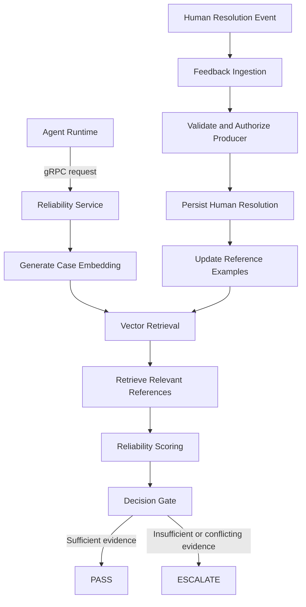

# ARDA Reliability Service

**The reliability layer for AI agent decisions.**

ARDA Reliability Service evaluates proposed agent decisions against relevant historical cases and determines whether the decision can proceed or should be escalated for human review.

It is a Python service within the ARDA platform, responsible for retrieving relevant reference examples, evaluating evidence, calculating reliability scores, and applying a configurable decision gate.

The goal is not to make agents appear more confident. It is to make their decisions easier to evaluate, question, and audit.

---

## Why this exists

An AI agent can produce a convincing answer without necessarily producing a reliable one.

In workflows involving financial transactions, refunds, disputes, or other consequential operations, accepting every agent decision without additional checks creates unnecessary risk.

ARDA approaches this problem through precedent-based evaluation.

When an agent proposes a decision, the Reliability Service:

1. Receives the original case description and proposed decision.
2. Retrieves relevant historical reference examples.
3. Evaluates how the retrieved examples relate to the proposed decision.
4. Calculates a reliability score using agreement, evidence density, and coverage.
5. Applies a decision gate.
6. Returns either `PASS` or `ESCALATE`.

A low-confidence decision, insufficient evidence, or conflicting precedent should not silently pass through the system.

## How it works

At a high level, the service follows this workflow:



The original case description is used for embedding and retrieval. The proposed decision and retrieved reference labels are evaluated separately. This separation is important: the service should not embed the proposed outcome and accidentally make retrieval depend on the answer it is supposed to evaluate.

## Core responsibilities

### 1. Reference example retrieval

The service uses PostgreSQL with pgvector to store and retrieve historical reference examples.

Each reference example is scoped to a tenant and an agent. Retrieval queries enforce both boundaries to prevent examples belonging to another tenant or agent from influencing an evaluation.

The current embedding model used in the retrieval experiments is:

- **Model:** `BAAI/bge-small-en-v1.5`
- **Embedding dimensions:** 384
- **Similarity metric:** Cosine similarity
- **Vector index:** HNSW

Reference examples can be marked active or quarantined. Only active examples are eligible for retrieval.

### 2. Reliability scoring

The scoring engine evaluates retrieved evidence using three components:

- **Agreement:** How strongly the retrieved examples support the proposed decision.
- **Density:** How relevant and sufficiently strong the retrieved evidence is.
- **Coverage:** Whether the retrieved evidence provides sufficient breadth and consistency.

The current scoring formula is:

\[
R = A \times D \times C
\]

Where:

- \(A\) = Agreement
- \(D\) = Evidence density
- \(C\) = Evidence coverage

The resulting raw score is evaluated by the decision engine alongside additional conditions, including minimum evidence requirements and conflicting precedents.

Similarity is not treated as a probability of correctness. A high similarity score alone does not mean a proposed decision is correct.

### 3. Decision gate

The service produces one of two outcomes:

| Decision | Meaning |
|---|---|
| `PASS` | Available evidence satisfies the configured reliability requirements. |
| `ESCALATE` | Evidence is insufficient, weak, or conflicting and requires further review. |

Some important escalation conditions include:

- Cold start or insufficient reference examples.
- Insufficient evidence coverage.
- Weak evidence density.
- Conflicting historical decisions.
- Highly similar references with opposing labels.
- Reliability score below the configured threshold.

The service deliberately favors escalation when evidence is insufficient rather than treating a lack of precedent as approval.

### 4. Confidence calibration

Raw reliability scores and calibrated confidence are kept separate.

Calibration research evaluates whether raw scores can be mapped to empirically meaningful confidence estimates. The current synthetic evaluation dataset did not demonstrate meaningful predictive improvement over a constant baseline.

For that reason, production calibration is not enabled as an established capability.

Calibration must not silently change the PASS/ESCALATE decision.

### 5. Human feedback ingestion

Human resolutions can become new reference examples.

The service consumes events from Redpanda:

- `arda.human-resolutions.v1`
- `arda.human-resolutions.dlq`

The ingestion pipeline handles:

- Event validation and producer authentication.
- HMAC-SHA256 signature verification.
- Timestamp freshness checks.
- Duplicate event detection.
- Reference example persistence.
- Conflicting resolution detection.
- Dead-letter routing.
- Manual Kafka offset management.

Human resolutions are treated as authoritative input only after passing the ingestion checks.

When two opposing human resolutions are received for the same tenant, agent, and case, the existing reference is quarantined instead of silently overwriting its label. Quarantined references are excluded from future retrieval.

---

## Architecture

The service follows a Hexagonal Architecture (Ports and Adapters) approach.

Business rules are kept separate from infrastructure concerns. The domain and application layers should not depend directly on PostgreSQL, Redpanda, or gRPC implementations.

The main architectural areas are:

| Layer | Responsibility |
|---|---|
| Domain | Reliability scoring, decision rules, entities, and domain exceptions. |
| Application | Use cases and ports defining required dependencies. |
| Infrastructure | PostgreSQL, pgvector, embeddings, Redpanda, and external integrations. |
| API / Transport | gRPC server and request/response handling. |

### Technology stack

| Technology | Purpose |
|---|---|
| Python | Reliability Service implementation |
| gRPC | Communication with the Go Agent Runtime |
| PostgreSQL | Persistent storage |
| pgvector | Vector storage and similarity retrieval |
| SQLAlchemy | Database access |
| Alembic | Database migrations |
| Sentence Transformers | Text embeddings |
| Redpanda / Kafka | Asynchronous human feedback ingestion |
| Pydantic | Configuration and data validation |
| pytest | Automated testing |
| Ruff | Linting and formatting |
| Mypy | Static type checking |

### Communication

The Reliability Service communicates synchronously with the Go Agent Runtime through gRPC.

Human resolution events are processed asynchronously through Redpanda. This keeps feedback ingestion separate from the synchronous agent evaluation path.

The service also uses PostgreSQL transactions to maintain consistency between event processing and reference example persistence.

---

## Security and reliability considerations

Security and data isolation are part of the service's design, not optional additions.

Current safeguards include:

- Tenant-scoped and agent-scoped retrieval.
- HMAC-SHA256 verification of trusted producer events.
- Timestamp freshness validation.
- Producer-specific signing keys and key ID support.
- Idempotent event ingestion.
- Conflict quarantine for contradictory human resolutions.
- Manual Kafka offset commits.
- DLQ acknowledgement before committing rejected messages.
- Exclusion of quarantined references from retrieval.

The upstream human review service is responsible for authenticating reviewers, enforcing reviewer RBAC, and validating tenant membership before publishing signed resolution events.

The Reliability Service verifies the trusted producer's signature. It does not independently implement reviewer RBAC.

Production deployment still requires secure provisioning and rotation of signing keys.

---

## Research and engineering decisions

Several implementation decisions are based on experiments rather than assumptions.

### Similarity is not decision correctness

Experiments with contrastive examples showed that semantically similar cases can have opposite outcomes.

In the contrastive evaluation, the opposite-label counterpart was retrieved at rank one for all 20 contrastive queries.

This demonstrated why nearest-neighbor similarity cannot be used as a standalone decision classifier.

The scoring engine therefore evaluates retrieved labels separately and includes conflict detection.

### HNSW versus exact retrieval

HNSW was benchmarked at different dataset sizes.

At small dataset sizes, PostgreSQL may prefer exact retrieval because it is cheaper. At larger sizes, the HNSW index becomes useful.

Filtered vector retrieval also requires care: tenant and agent filters, candidate limits, and iterative scanning settings can affect recall.

The selected index configuration is an experimentally evaluated starting point, not a universal guarantee of retrieval quality.

### Calibration is evidence-driven

The initial synthetic evaluation did not establish that calibration provides meaningful predictive improvement.

Rather than presenting an unvalidated confidence value as a probability, the service keeps raw reliability scoring separate from calibrated confidence.

Further calibration requires a substantially larger collection of independently resolved real-world cases.

---

## Current implementation status

The following capabilities have been implemented and tested during development:

- [x] Reference dataset creation and ingestion.
- [x] Embedding generation.
- [x] PostgreSQL and pgvector integration.
- [x] Tenant-scoped and agent-scoped retrieval.
- [x] HNSW benchmarking and retrieval evaluation.
- [x] Reliability scoring engine.
- [x] PASS / ESCALATE decision gate.
- [x] Calibration evaluation and contract separation.
- [x] gRPC communication with the Go service.
- [x] Asynchronous human feedback ingestion.
- [x] Redpanda consumer and DLQ handling.
- [x] Conflict detection and reference quarantine.
- [x] HMAC-SHA256 producer authentication.
- [x] Cross-language Go/Python signing interoperability tests.

### Remaining integration work

- Implement the upstream Go human-review producer and event publisher.
- Provision production signing keys through a secure secret-management mechanism.
- Complete production deployment and operational observability.
- Validate the scoring and calibration approach using independently collected human-resolved cases.

The implementation status above reflects the current development state. It should not be interpreted as a claim of production readiness.

---

## Running tests

From the repository root, activate the project's Python virtual environment and run:

```bash
# Run the complete test suite
.venv/bin/pytest tests/

# Lint
.venv/bin/ruff check src tests

# Check formatting
.venv/bin/ruff format --check src tests

# Static type checking
.venv/bin/mypy src tests
```

The cross-language interoperability test requires the Go toolchain:

```bash
.venv/bin/pytest tests/test_cross_language_interop.py -v
```

The live Redpanda integration test additionally requires the corresponding Redpanda and PostgreSQL services to be available:

```bash
.venv/bin/pytest tests/test_redpanda_real_integration.py -v
```

---

## Part of ARDA

ARDA (Auditable, Reliable, Durable Agents) is a platform for executing and governing AI agents.

The Reliability Service is one component of that platform. Its responsibility is narrow but important: evaluate the evidence behind agent decisions and provide a consistent mechanism for passing or escalating them.

It does not replace the agent, execute the agent's tools, or make human review decisions. It provides a reliability check between an agent's proposed decision and the next stage of execution.

**The objective is simple: agent decisions should not only be executable. They should be explainable, reviewable, and backed by evidence.**