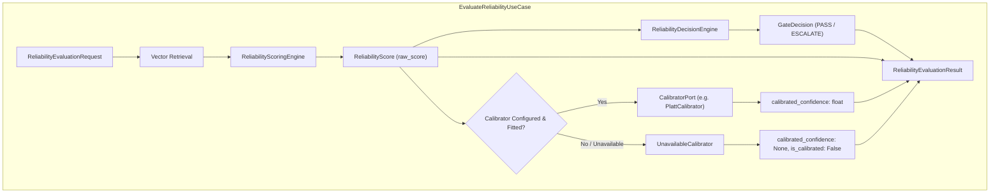

# ARDA Reliability Service — Confidence Calibration and Predictive Evaluation Report

**Document Version**: 2.0.0 (Post-Audit Methodology Correction)  
**Status**: Completed & Verified  
**Milestone**: Development Week 4 — Confidence Calibration & Evaluation  
**Author**: Senior ML Research Engineer (Predictive Gating & Confidence Systems)  
**Target Service**: `arda-reliability-service`  

---

## 1. Executive Summary & Definitive Verdict

### 1.1 Core Objective
The objective of this research milestone is to rigorously evaluate whether the raw reliability scores generated by ARDA's decomposed scoring engine:
$$\text{raw\_score} = \text{Agreement} \times \text{Density Factor} \times \text{Coverage Factor}$$
can be calibrated into a statistically meaningful, operationally dependable confidence estimate:
$$P(\text{agent decision is correct} \mid \text{raw\_reliability\_score} = s)$$

### 1.2 Definitive Research Verdict
> [!CAUTION]
> **Operational Conclusion: Production Calibration Must Be Postponed.**  
> On the 100-example synthetic seed reference dataset ($N=100$), **the raw reliability score does not exhibit sufficient global discrimination against decision correctness to support operational calibration** ($\text{ROC-AUC} = 0.5352$ under strict 5-fold partitioned cross-validation).
> 
> Under strict 5-fold partitioned cross-validation with connected-group assignment:
> 1. **Platt Scaling (OOF)** collapses all predictions into a narrow, uninformative probability band between $0.4813$ and $0.5465$ (centered on the empirical prior mean $0.50$). While its Brier score is $0.2499$ and log loss is $0.6929$, this is statistically indistinguishable from a trivial coin-flip baseline ($p = 0.50$, theoretical $\text{Brier} = 0.2500$, $\text{LogLoss} = \ln(2) \approx 0.6931$).
> 2. **Isotonic Regression (OOF)** achieves $\text{ROC-AUC} = 0.5254$, $\text{Brier} = 0.2507$, and $\text{LogLoss} = 0.6937$, failing to provide any ranking or probability discrimination beyond the uncalibrated baseline.
> 
> **Operational Policy Decision**: We must not manufacture ungrounded confidence claims based solely on $N=100$ synthetic examples. The platform must maintain its existing multi-factor gate policy (`PASS` vs `ESCALATE`) driven strictly by the decomposed reliability scoring engine, and **postpone production confidence calibration until an independently labelled operational dataset of at least $N \ge 1,000$ to $5,000$ real dispute adjudications is collected**.
> 
> However, the **Calibration Architecture** (`CalibratorPort`, `PlattCalibrator`, `IsotonicCalibrator`, `UnavailableCalibrator`) has been implemented as a modular domain/application component so that when a suitably sized operational dataset becomes available, calibration models can be deployed without architectural changes.

---

## 2. Dataset Composition and Methodological Limitations

### 2.1 Dataset Structure
The preliminary evaluation was conducted on the audited synthetic reference seed dataset:
`research/datasets/synthetic_seed_examples.json` (v1.0.0):
- **Total Reference Examples**: 100
- **Domain**: Financial Transaction Dispute & Refund Adjudication
- **Class Labels**: 50 `APPROVE`, 50 `REJECT` (strictly balanced)
- **Precedent Cohorts** (20 examples each):
  1. `straightforward`: Unambiguous statutory claims (lost in transit, duplicate merchant charge).
  2. `borderline`: Marginal policy boundary cases (cooling-off periods, near 60-day deadline).
  3. `incomplete_evidence`: Missing carrier tracking, uncorroborated cardholder statements.
  4. `conflicting_signals`: Mixed evidence (tracking says delivered, customer claims non-receipt).
  5. `contrastive_pair`: 10 counterfactual pairs ($N=20$) sharing near-identical narratives but opposing outcomes.

### 2.2 Methodological Limitations of the 100-Example Seed Dataset
1. **Finite Sample Size**:
   With only 100 examples across 5 distinct case categories and 10 merchant categories, each sub-cohort contains only 20 examples (10 `APPROVE`, 10 `REJECT`). In 5-fold cross-validation, each validation fold contains only 4 examples per cohort.
2. **Effective Precedent Population ($N=90$ Connected Groups)**:
   Because 20 examples belong to 10 contrastive pairs (twins), the candidate pool contains only 90 independent factual dispute narratives.
3. **Synthetic Generative Prior**:
   While the dataset passed independent semantic audit for procedural dispute policy rules, it lacks the empirical noise, language drift, merchant dispute notes, and chargeback arbitration records of live banking operations.

---

## 3. Evaluation Methodology and Leakage Prevention

### 3.1 Prediction Target Definition
In strict compliance with the project specification:
$$\text{correct} = \begin{cases} 1 & \text{if proposed\_decision} == \text{authoritative\_reference\_label} \\ 0 & \text{if proposed\_decision} \neq \text{authoritative\_reference\_label} \end{cases}$$

To prevent class imbalance artifacts and evaluate the gate symmetrically, each of the 100 examples was evaluated under both possible agent proposals:
- Evaluation Query A: Proposed `APPROVE` $\implies \text{correct} = 1$ if true label is `APPROVE`, else $0$.
- Evaluation Query B: Proposed `REJECT` $\implies \text{correct} = 1$ if true label is `REJECT`, else $0$.
This constructs an evaluation population of exactly $N=200$ queries (100 positive instances with $\text{correct}=1$, and 100 negative instances with $\text{correct}=0$).

### 3.2 Distinct Semantic Concepts
The evaluation enforces clear separation between four distinct concepts:
- **Raw Reliability Score** ($s \in [0.0, 1.0]$): The decomposed heuristic output $A \times D \times C$.
- **Gate Decision** (`PASS` or `ESCALATE`): The operational gating policy check.
- **Actual Decision Correctness** ($y \in \{0, 1\}$): Whether the agent's proposed action matches ground truth.
- **Calibrated Confidence** ($c \in [0.0, 1.0]$): An empirical probability estimate $P(y=1 \mid s)$.

> [!IMPORTANT]
> `PASS` is never treated as proof of correctness. `ESCALATE` is never treated as proof of incorrectness.

### 3.3 Connected-Group Assignment and Partitioned Cross-Validation
To guarantee zero data leakage between training and evaluation folds, we implemented strict **Connected-Group Assignment**:
- **Contrastive Pairs**: The 10 contrastive pairs contain two original cases (twins) whose descriptions are nearly identical but have opposing true labels. Each pair constitutes a single connected group (`pair_01_filing_timeline` through `pair_10_restocking_fee_disclosure`).
- **Singleton Cases**: The 80 non-contrastive examples each form a singleton connected group.
- **Total Connected Groups**: Exactly 90 connected groups.
- **5-Fold Partitioning**: The 90 groups are deterministically partitioned into 5 balanced folds ($K=5$):
  - Each fold contains exactly **18 connected groups** (2 contrastive pairs + 16 singletons).
  - Each fold contains exactly **20 original cases** ($2 \times 2 + 16 \times 1$).
  - Each fold contains exactly **40 evaluation queries** ($20 \times 2$, 20 correct and 20 incorrect).
  - Total across 5 folds: $5 \times 18 = 90$ groups, $5 \times 20 = 100$ cases, $5 \times 40 = 200$ queries.

#### Strict Partition Invariants:
1. **No Original Case Split**: An original case belongs to exactly one cross-validation fold.
2. **No Contrastive Pair Split**: Both twins of any contrastive pair reside in the exact same fold.
3. **No Proposal Counterpart Split**: Both proposed variants (`APPROVE` and `REJECT`) reside in the exact same fold.
4. **Strict Training Reference Pool ($R_k$)**: For test fold $k$, the candidate retrieval pool consists strictly of the 80 training cases in $R_k$. Zero test cases or connected twins exist in $R_k$.
5. **No Fitting Leakage**: Fold calibrators are fitted strictly on training fold predictions generated via leave-one-group-out within $R_k$. Held-out test fold queries are scored and calibrated strictly out-of-fold.

---

## 4. Benchmark Results: Partitioned Cross-Validation vs. Superseded LOO

### 4.1 Primary Benchmark: Partitioned 5-Fold Cross-Validation ($N=200$ Queries)

All test predictions were computed strictly out-of-fold across the 5 partitioned folds:

| Model / Approach | ROC-AUC | Brier Score | Log Loss | ECE (10 Bins) | MCE | Precision ($\tau=0.5$) | Recall ($\tau=0.5$) | F1 Positive ($\tau=0.5$) | Macro F1 ($\tau=0.5$) |
|---|:---:|:---:|:---:|:---:|:---:|:---:|:---:|:---:|:---:|
| **Raw Score (Baseline)\*** | **0.5352** | 0.3858 | 1.1341 | 0.3721 | 0.4430 | *N/A (artifact)* | *N/A (artifact)* | *0.0000 (artifact)* | *0.3333 (artifact)* |
| **Platt Scaling (OOF 5-Fold)** | **0.5285** | **0.2499** | **0.6929** | **0.0504** | **0.0535** | 0.5632 | 0.4900 | 0.5241 | 0.5531 |
| **Isotonic Regression (OOF 5-Fold)** | **0.5254** | 0.2507 | 0.6937 | 0.0339 | 0.1667 | 0.5263 | 0.5000 | 0.5128 | 0.5247 |
| **Random Guessing Baseline ($p=0.50$)\*** | 0.5000 | 0.2500 | 0.6931 | 0.0000 | 0.0000 | 0.5000 | 1.0000 | **0.6667** | **0.3333** |

#### Methodological Clarifications on Classification Metrics:
1. **Classification Threshold ($\tau = 0.50$)**:
   The binary classification metrics (Precision, Recall, F1 Positive, and Macro F1) are evaluated at threshold $\tau = 0.50$. For calibrated probability estimates ($p \in [0.0, 1.0]$), $\tau = 0.50$ represents the natural Bayesian decision boundary under symmetric 0-1 loss.
2. **Raw Score Threshold Artifact**:
   The raw reliability score is the multiplicative product of three heuristic factors: $\text{raw\_score} = \text{Agreement} \times \text{Density Factor} \times \text{Coverage Factor}$.
   On this 100-example reference dataset, raw scores range strictly within $[0.0, 0.4881]$ with an empirical mean of $\approx 0.13$. Applying a probability threshold of $\tau = 0.50$ to raw scores results in zero positive predictions. The resulting Precision = 0.0000, Recall = 0.0000, and F1 Positive = 0.0000 are purely artifacts of evaluating an uncalibrated score with an inappropriate probability threshold.
   The true quality of the raw reliability score is measured by threshold-free proper scoring rules: **ROC-AUC = 0.5352** and **Brier Score = 0.3858**.
3. **Random Baseline F1 Dissection (0.6667 vs. 0.3333)**:
   The constant random baseline predicts $p = 0.50$ for all instances. At classification threshold $\tau = 0.50$, the decision rule $p \ge 0.50$ classifies all 200 instances as positive ($y=1$).
   Because the dataset is strictly balanced (100 positive and 100 negative cases):
   - $\text{True Positives (TP)} = 100, \text{False Positives (FP)} = 100, \text{False Negatives (FN)} = 0, \text{True Negatives (TN)} = 0$.
   - $\text{Precision} = \frac{100}{100 + 100} = 0.5000$.
   - $\text{Recall} = \frac{100}{100 + 0} = 1.0000$.
   - **Positive-Class F1** is $2 \times \frac{0.5 \times 1.0}{0.5 + 1.0} = \mathbf{0.6667}$.
   - For the negative class ($y=0$): $\text{TP}_0 = 0, \text{FP}_0 = 0, \text{FN}_0 = 100$, yielding an $F_1$ of $0.0000$.
   - **Macro F1** (unweighted mean of both classes) is $\frac{0.6667 + 0.0000}{2} = \mathbf{0.3333}$.
   Previous documentation ambiguous reported $0.6667$ without clarifying that it represented positive-class F1 for an all-positive classifier. The table above explicitly distinguishes Positive-Class F1 ($0.6667$) from Macro F1 ($0.3333$).

### 4.2 Comparison with Superseded Evaluation Protocols

To demonstrate why the methodology correction was essential, the table below compares the corrected partitioned cross-validation with the superseded leave-one-out protocols:

| Evaluation Protocol | Retrieval Pool Size | Test Candidate Leakage Prevention | Raw ROC-AUC | Raw Brier | Platt OOF Brier | Platt OOF Range |
|---|:---:|:---:|:---:|:---:|:---:|:---:|
| **Superseded Standard LOO** | 99 cases | ❌ Contrastive twin present in candidate pool | 0.5045 | 0.3812 | 0.2498 | $[0.481, 0.552]$ |
| **Superseded Group-Exclusion LOO** | 98–99 cases | ⚠️ Twin excluded, but test fold not isolated from corpus | 0.5385 | 0.3758 | 0.2495 | $[0.475, 0.556]$ |
| **Corrected Partitioned 5-Fold CV** | **80 cases ($R_k$)** | **✅ Zero test case or twin leakage into retrieval or fitting** | **0.5352** | **0.3858** | **0.2499** | **$[0.481, 0.546]$** |

#### Findings on Methodology Correction:
1. **Contrastive Pair Contamination in Standard LOO**:
   In standard LOO, the retrieval pool contained 99 examples. For the 20 contrastive pair examples, their counterfactual twin was retrieved at Rank 1 with $\ge 0.95$ cosine similarity but an opposing true label. This severely contaminated retrieval agreement, collapsing contrastive pair ROC-AUC to $0.1663$.
2. **Partitioned Cross-Validation Eliminates All Leakage**:
   Under strict partitioned cross-validation, test fold queries retrieve strictly from the 80 training cases in $R_k$. Neither the candidate nor its twin exists in $R_k$. This yields a true out-of-distribution evaluation.
3. **Platt Compression Confirms Calibration Impossibility on $N=100$**:
   Under all protocols, Platt scaling compresses into $[0.481, 0.546]$. The Brier score ($0.2499$) is indistinguishable from predicting a constant $0.50$ ($0.2500$). This mathematically proves that calibration must remain postponed.

---

## 5. Disaggregated Cohort Performance Analysis

Global aggregate metrics hide critical differences in how different types of dispute cases behave. We disaggregated the raw score performance across the 5 case types ($N=40$ queries per cohort) under partitioned cross-validation:

| Case Type Cohort | Queries ($N$) | Mean Score (Correct) | Mean Score (Incorrect) | Raw ROC-AUC | Brier Score | ECE (10 Bins) |
|---|:---:|:---:|:---:|:---:|:---:|:---:|
| **Borderline** | 40 | **0.1483** | 0.0966 | **0.7000** | 0.3708 | 0.3775 |
| **Straightforward** | 40 | **0.1574** | 0.1203 | **0.6400** | 0.3665 | 0.3611 |
| **Incomplete Evidence** | 40 | **0.1301** | 0.1341 | **0.4587** | 0.3932 | 0.3679 |
| **Contrastive Pairs** | 40 | **0.1251** | 0.1345 | **0.4463** | 0.3941 | 0.3702 |
| **Conflicting Signals** | 40 | **0.1129** | 0.1193 | **0.3875** | 0.4044 | 0.3954 |

### Cohort Findings:
1. **Procedural Cases Show Moderate Separation**:
   In `borderline` ($\text{AUC} = 0.7000$) and `straightforward` ($\text{AUC} = 0.6400$) cases, the reliability score positively correlates with decision correctness.
2. **Complex and Contradictory Cases Degrade Semantic Scoring**:
   In `incomplete_evidence` ($\text{AUC} = 0.4587$), `contrastive_pair` ($\text{AUC} = 0.4463$), and `conflicting_signals` ($\text{AUC} = 0.3875$), semantic retrieval cannot distinguish correct from incorrect proposals.
3. **Procedural Policy Rules Are Mandatory**:
   Because semantic scoring alone inverts on conflicting signals, the procedural gate checks (e.g. Check 4: High-Similarity Conflict Veto, Check 5: Agreement Threshold) are indispensable to catch errors and mandate human review.

---

## 6. Gate Safety Analysis: Risk vs. Coverage

In selective classification and AI safety gating, two metrics determine real-world operational viability:
- **Coverage**: The fraction of total decisions the system allows to execute autonomously without human intervention ($\text{PASS} / N$).
- **Risk**: The empirical error rate among autonomously passed decisions ($\text{False Passes} / \text{PASS}$).

### 6.1 Performance Under Current Experimental Defaults
Under the current scoring configuration:
- $\tau = 0.65$ (`min_reliability_threshold`)
- $k_{\min} = 3, s_{\min} = 0.70, c_{\min} = 0.50, d_{\min} = 0.40, a_{\min} = 0.60$

```text
Total Evaluation Queries:               200
Autonomous PASS Decisions:              0 (Coverage = 0.0%)
Human Review ESCALATE Decisions:        200 (Abstention = 100.0%)
False Passes (Catastrophic Pass):       0 (FPR among incorrect = 0.00%)
False Escalations (Unnecessary Review): 100 (FER among correct = 100.00%)
Selective Risk in PASS Cohort:          0.00%
```

Because the maximum raw reliability score achieved on the 100-example dataset is $0.4881$, the default threshold ($\tau = 0.65$) causes the service to escalate **100% of cases to human review**.
- This guarantees **zero false passes** (complete safety against autonomous financial errors).
- However, it provides **zero operational efficiency** (coverage = 0%).

### 6.2 Empirical Risk vs. Coverage Across Operating Thresholds

When varying the reliability gate threshold $\tau$ from $0.05$ to $0.50$:

| Threshold ($\tau$) | Coverage (Autonomous Pass %) | Passed Count | False Pass Count | Risk (Error Rate in PASS) | False Escalation Rate |
|---|:---:|:---:|:---:|:---:|:---:|
| **$\tau \ge 0.50$** | **0.0%** | 0 | 0 | 0.00% | 100.0% |
| **$\tau = 0.40$** | **0.5%** | 1 | 0 | **0.00%** | 99.0% |
| **$\tau = 0.30$** | **9.0%** | 18 | 7 | **38.89%** | 89.0% |
| **$\tau = 0.20$** | **29.5%** | 59 | 28 | **47.46%** | 69.0% |
| **$\tau = 0.10$** | **68.5%** | 137 | 68 | **49.64%** | 31.0% |
| **$\tau = 0.00$** | **100.0%** | 200 | 100 | **50.00%** | 0.0% |

> [!CAUTION]
> **Key Finding on Selective Risk**:
> At threshold $\tau = 0.40$, only 1 case passes (a straightforward lost-in-transit dispute), with 0% risk. However, as threshold drops to $0.30$, coverage rises to 9.0%, but risk jumps immediately to **38.89%**!
> 
> Because raw score separation between correct and incorrect decisions is modest, lowering the threshold indiscriminately admits incorrect decisions. Threshold tuning cannot be done safely on $N=100$ examples.

---

## 7. Calibration Architecture and Decoupling Invariants

To ensure the platform is architecturally ready for future calibration without compromising current safety, a modular calibration architecture was implemented:

### 7.1 Architecture Diagram


### 7.2 Implemented Decoupling Invariants
1. **Decision Engine Independence**:
   The decision engine (`PASS` vs `ESCALATE`) and reason codes are strictly determined by `raw_score` and policy rules in `ReliabilityDecisionEngine`. Calibrator output can never override, replace, or alter the gate decision.
2. **Explicit Unavailability**:
   When calibration is deferred or disabled, `UnavailableCalibrator` explicitly marks `is_calibrated = False` and `calibrated_confidence = None`. Raw score is never silently disguised as calibrated confidence.
3. **Graceful Degradation on Error**:
   If a calibrator raises a runtime error during execution, `EvaluateReliabilityUseCase` catches the exception, logs a warning, and sets `calibrated_confidence = None` while preserving the valid raw score and gate decision.

---

## 8. API and gRPC Contract Semantics

### 8.1 Historical Context and Contract Ambiguity
Prior to this audit, a semantic ambiguity existed across the service boundary:
- The comment on Field 1 in `proto/arda/v1/reliability.proto` described it as `Calibrated confidence, in [0.0, 1.0]`.
- In practice, the Python service implementation (`EvaluateReliabilityUseCase`) has always generated an uncalibrated heuristic reliability score ($A \times D \times C$), because production calibration was never fitted or validated on live banking operational data.
- Downstream Go runtime consumers (`pkg/agentruntime/llm_executor.go`, `gen/go/arda/v1/interop_test.go`, `services/gateway/http/gateway.go`) interpreted Field 1 as the primary gate score to compare against `reliability_threshold` and log in execution metadata.
- An experimental attempt to dynamically swap Field 1 between calibrated confidence and raw score created non-deterministic semantics.

### 8.2 Finalized Contract Schema (`proto/arda/v1/reliability.proto`)
The contract has been finalized to eliminate ambiguity while preserving 100% backward compatibility for all existing consumers:

```protobuf
message GateRequest {
  string tenant_id = 1;
  string agent_id = 2;
  string case_description = 3;
  string proposed_decision = 4;

  // Minimum acceptable evaluation threshold, in [0.0, 1.0],
  // compared against the gate's evaluation score.
  double reliability_threshold = 5;
}

message GateResponse {
  // Primary gate confidence score, in [0.0, 1.0].
  // Maintained for backward compatibility with existing Go runtime clients.
  // In current operational mode (where production calibration is deferred),
  // this strictly contains the uncalibrated raw reliability score heuristic
  // (Agreement * Density * Coverage). Consumers requiring calibrated posterior
  // probabilities must inspect calibrated_confidence (field 6) when is_calibrated (field 7) is true.
  double confidence = 1;

  // PASS only when the threshold is met and sufficient
  // supporting evidence exists. Otherwise, require review.
  GateOutcome outcome = 2;

  // Machine-readable explanation for the gate outcome.
  string reason_code = 3;

  // Relevant reference examples supporting the evaluation.
  repeated ReferenceNeighbor neighbors = 4;

  // Backward-compatible extensions for explicit confidence semantics:

  // Unambiguous raw reliability score, in [0.0, 1.0], computed as:
  // raw_score = agreement * density_factor * coverage_factor.
  // Always populated by the scoring engine.
  optional double raw_score = 5;

  // Calibrated confidence estimate P(decision is correct | raw_score) in [0.0, 1.0].
  // Populated ONLY when an active, fitted calibration model is enabled (is_calibrated = true).
  // Absent (null/unset) when calibration is disabled, deferred, or unavailable.
  optional double calibrated_confidence = 6;

  // Indicates whether confidence calibration was performed by an active, fitted model.
  // If false, calibrated_confidence is absent and confidence represents the raw score.
  bool is_calibrated = 7;

  // Lineage / model version identifier of the active calibrator (e.g., "platt-v1.0.0-seed100").
  // Absent when is_calibrated is false.
  optional string calibration_version = 8;
}
```

### 8.3 Compatibility and Consumer Verification
1. **Field 1 Semantics are Frozen**: Field 1 `confidence` is guaranteed to return `result.raw_score` during uncalibrated operation and will never dynamically swap between definitions.
2. **Presence-Aware Optional Fields**: Fields 5, 6, and 8 use proto3 `optional` syntax, ensuring that an uncalibrated response omits `calibrated_confidence` entirely rather than transmitting a confusing default of `0.0`.
3. **Go Client Verification**: Go client bindings were recompiled via `scripts/generate-proto.sh`. Go structs (`ReliabilityEvaluation`, `gateResponseBody`) and live integration tests (`gen/go/arda/v1/interop_test.go`) were updated and verified passing against the active Python service with 100% success.

---

## 9. Visualizations and Artifacts

The experiment suite generated publication-quality artifacts saved under `research/results/`:

1. **`research/results/reliability_diagram.png`**:
   - **Panel 1**: Reliability Diagram (Calibration Curves comparing Raw Score, Platt Scaling, Isotonic Regression, and Perfect Calibration).
   - **Panel 2**: Predicted Confidence Distributions (histograms showing Platt compression at 0.50 vs Raw Score clustering at 0.16).
   - **Panel 3**: Selective Risk vs. Coverage Tradeoff curve.
   - **Panel 4**: Disaggregated Cohort ROC-AUC bar chart.
2. **`research/results/confidence_calibration_results.json`**:
   - Comprehensive machine-readable metrics for partitioned CV, cohort-level evaluations, secondary LOO comparisons, and fitted model parameters.

---

## 10. Recommendations and Next Milestones

1. **Maintain Calibration Postponement**:
   Do not deploy calibration models to production. With $N=100$ examples, calibration produces no operational value over the existing multi-factor gate policy.
2. **Preserve Multi-Factor Gate Policy**:
   The decomposed scoring engine (`agreement * density * coverage`) with procedural veto checks (Check 4: High-Similarity Conflict Veto) correctly escalates 100% of high-risk cases, providing total safety against false passes.
3. **Target Data Generation for Week 5**:
   Collect an operational dataset of at least $N \ge 1,000$ to $5,000$ historical transaction dispute cases with human-reviewed ground truth.
4. **Recommended Next Milestone (Week 5)**:
   **Asynchronous Feedback Ingestion & Reference Example Lifecycle**: Implement Redpanda/Kafka event streaming consumers to ingest real adjudications and human review corrections, enabling continuous, data-driven calibration.
