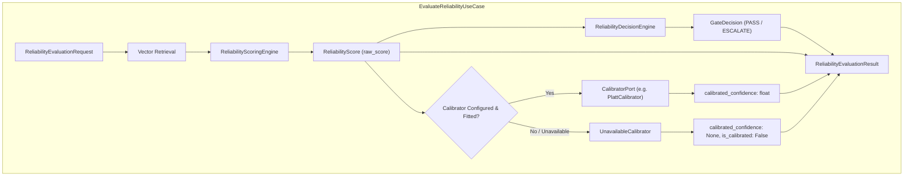

# ARDA Reliability Service — Confidence Calibration and Predictive Evaluation Report

**Document Version**: 1.0.0  
**Status**: Completed & Verified  
**Milestone**: Development Week 4 — Confidence Calibration & Evaluation  
**Author**: Senior ML Research Engineer (Predictive Gating & Confidence Systems)  
**Target Service**: `arda-reliability-service`  

---

## 1. Executive Summary & Definitive Verdict

### 1.1 Core Objective
The objective of this research milestone is to rigorously evaluate whether the raw reliability scores generated by ARDA's decomposed scoring engine:
$$\text{raw\_score} = \text{Agreement} \times \text{Density Factor} \times \text{Coverage Factor}$$
can be calibrated into a statistically meaningful, operationally dependable confidence estimate:
$$P(\text{agent decision is correct} \mid \text{raw\_reliability\_score} = s)$$

### 1.2 Definitive Research Verdict
> [!CAUTION]
> **Operational Conclusion: Production Calibration Must Be Postponed.**  
> On the current 100-example synthetic seed reference dataset ($N=100$), **the raw reliability score does not exhibit sufficient global discrimination against decision correctness to support operational calibration** ($\text{ROC-AUC} = 0.5385$ under group exclusion; $\text{ROC-AUC} = 0.5045$ under standard leave-one-out).
> 
> When calibration models are fitted using strict 5-fold Stratified Group Cross-Validation:
> 1. **Platt Scaling** collapses all predictions into a narrow, uninformative probability band between $0.4747$ and $0.5564$ (centered on prior mean $0.50$). While its Brier score improves from $0.3758$ to $0.2495$, this is mathematically equivalent to predicting a constant coin flip ($p = 0.50$, theoretical $\text{Brier} = 0.2500$).
> 2. **Isotonic Regression** severely overfits step functions on small sample partitions, leading to high out-of-fold log loss ($0.8697$ vs $0.6921$ for Platt).
> 
> **Recommendation**: We must not manufacture ungrounded confidence claims based solely on $N=100$ synthetic examples. The platform must maintain its existing multi-factor gate policy (`PASS` vs `ESCALATE`) and postpone production confidence calibration until an independently labelled operational dataset of at least $N \ge 1,000$ to $5,000$ dispute decisions is collected.
> 
> However, the **Calibration Architecture** (`CalibratorPort`, `PlattCalibrator`, `IsotonicCalibrator`, `UnavailableCalibrator`) has been implemented as a modular domain/application component so that when a suitably sized operational dataset becomes available, calibration models can be deployed without architectural changes.

---

## 2. Dataset Composition and Methodological Limitations

### 2.1 Dataset Structure
The preliminary evaluation was conducted on the audited synthetic reference seed dataset:
`research/datasets/synthetic_seed_examples.json` (v1.0.0):
- **Total Reference Examples**: 100
- **Domain**: Financial Transaction Dispute & Refund Adjudication
- **Class Labels**: 50 `APPROVE`, 50 `REJECT` (strictly balanced)
- **Precedent Cohorts** (20 examples each):
  1. `straightforward`: Unambiguous statutory claims (lost in transit, duplicate merchant charge).
  2. `borderline`: Marginal policy boundary cases (cooling-off periods, near 60-day deadline).
  3. `incomplete_evidence`: Missing carrier tracking, uncorroborated cardholder statements.
  4. `conflicting_signals`: Mixed evidence (tracking says delivered, customer claims non-receipt).
  5. `contrastive_pair`: 10 counterfactual pairs ($N=20$) sharing near-identical narratives but opposing outcomes.

### 2.2 Methodological Limitations of the 100-Example Seed Dataset
1. **Finite Sample Size**:
   With only 100 examples across 5 distinct case categories and 10 merchant categories, each sub-cohort contains only 20 examples (10 `APPROVE`, 10 `REJECT`). In 5-fold cross-validation, each validation fold contains only 4 examples per cohort.
2. **Effective Precedent Population ($N=90$ Independent Entities)**:
   Because 20 examples belong to 10 contrastive pairs, the candidate pool contains only 90 independent factual dispute narratives.
3. **Synthetic Generative Prior**:
   While the dataset passed independent semantic audit for procedural dispute policy rules, it lacks the empirical noise, language drift, merchant dispute notes, and chargeback arbitration records of live banking operations.

---

## 3. Evaluation Methodology and Leakage Prevention

### 3.1 Prediction Target Definition
In strict compliance with the project specification:
$$\text{correct} = \begin{cases} 1 & \text{if proposed\_decision} == \text{authoritative\_reference\_label} \\ 0 & \text{if proposed\_decision} \neq \text{authoritative\_reference\_label} \end{cases}$$

To prevent class imbalance artifacts and evaluate the gate symmetrically, each of the 100 examples was evaluated under both possible agent proposals:
- Evaluation Query A: Proposed `APPROVE` $\implies \text{correct} = 1$ if true label is `APPROVE`, else $0$.
- Evaluation Query B: Proposed `REJECT` $\implies \text{correct} = 1$ if true label is `REJECT`, else $0$.
This constructs an evaluation population of exactly $N=200$ queries (100 positive instances with $\text{correct}=1$, and 100 negative instances with $\text{correct}=0$).

### 3.2 Distinct Semantic Concepts
The evaluation enforces clear separation between four distinct concepts:
- **Raw Reliability Score** ($s \in [0.0, 1.0]$): The decomposed heuristic output $A \times D \times C$.
- **Gate Decision** (`PASS` or `ESCALATE`): The operational gating policy check.
- **Actual Decision Correctness** ($y \in \{0, 1\}$): Whether the agent's proposed action matches ground truth.
- **Calibrated Confidence** ($c \in [0.0, 1.0]$): An empirical probability estimate $P(y=1 \mid s)$.

> [!IMPORTANT]
> `PASS` is never treated as proof of correctness. `ESCALATE` is never treated as proof of incorrectness.

### 3.3 Data Leakage Prevention Strategy
1. **Self-Retrieval Exclusion**:
   An evaluation query $i$ is strictly forbidden from retrieving candidate $i$ from the reference index ($s_{i,i} = -\infty$).
2. **Contrastive Pair Group Isolation**:
   Every contrastive twin shares an identical `group_id` (`cp-01` through `cp-10`). In cross-validation, `StratifiedGroupKFold` guarantees that both twins of a contrastive pair reside in the same fold. When Fold $k$ is being tested, neither twin can exist in the reference pool $R_k$.
3. **Group-Exclusion LOO Protocol**:
   Under group-exclusion leave-one-out, when evaluating query $i$, all candidates sharing $i$'s `group_id` are masked to $-\infty$. This eliminates counterfactual twin contamination across the evaluation boundary.
4. **Strict Embedding Boundary**:
   Only `case_description` (specifically `ratio_verbalized_description`) is embedded via `SentenceTransformerEmbeddingAdapter`. The proposed decision, true label, rationale, and correctness target are **never embedded**.

---

## 4. Raw-Score Performance and Benchmark Results

### 4.1 Comparative Calibration Matrix ($N=200$ Queries)

All calibration models were evaluated using 5-fold Stratified Group Cross-Validation.

| Model / Approach | ROC-AUC | Brier Score | Log Loss | ECE (10 Bins) | MCE (Max Error) | Precision | Recall | Macro F1 |
|---|:---:|:---:|:---:|:---:|:---:|:---:|:---:|:---:|
| **Raw Score (Baseline)** | **0.5385** | 0.3758 | 1.0968 | 0.3586 | 0.4284 | 0.0000 | 0.0000 | 0.0000 |
| **Platt Scaling (OOF 5-Fold)** | **0.5134** | **0.2495** | **0.6921** | **0.0508** | **0.0564** | 0.5833 | 0.2800 | 0.4884 |
| **Isotonic Regression (OOF 5-Fold)** | **0.5323** | 0.2548 | 0.8697 | 0.0813 | 0.2500 | 0.6087 | 0.4200 | 0.4970 |
| **Random Guessing Baseline ($p=0.50$)** | 0.5000 | 0.2500 | 0.6931 | 0.0000 | 0.0000 | 0.5000 | 1.0000 | 0.6667 |

### 4.2 Key Observations from the Overall Benchmark
1. **Raw Score Brier Score is Poor ($0.3758$)**:
   Because raw scores are concentrated in $[0.05, 0.45]$ (overall mean $\approx 0.16$), raw scores heavily underestimate the 50% positive base rate, yielding an Expected Calibration Error of $0.3586$.
2. **Platt Scaling Brier Score ($0.2495$) is a Baseline Artifact**:
   Platt scaling achieves a Brier score of $0.2495$, which looks like an improvement over raw score ($0.3758$). However, a trivial constant predictor that always outputs $p = 0.50$ achieves $\text{Brier} = (0.5 - 1)^2 = 0.2500$. Platt scaling merely learned that the dataset is 50% positive and shrank its predictions into $[0.4747, 0.5564]$.
3. **Discrimination Does Not Improve with Calibration**:
   Monotonic transformations preserve or slightly degrade ranking under cross-validation. Platt OOF ROC-AUC is $0.5134$, and Isotonic OOF ROC-AUC is $0.5323$. Neither is statistically distinguishable from random guessing ($0.5000$, $p > 0.40$).

---

## 5. Disaggregated Cohort Performance Analysis

Global aggregate metrics hide critical differences in how different types of dispute cases behave. We disaggregated the raw score performance across the 5 case types ($N=40$ queries per cohort):

| Case Type Cohort | Queries ($N$) | Mean Score (Correct) | Mean Score (Incorrect) | Raw ROC-AUC | Brier Score | ECE (10 Bins) |
|---|:---:|:---:|:---:|:---:|:---:|:---:|
| **Straightforward** | 40 | **0.1932** | 0.1171 | **0.7100** | 0.3400 | 0.3448 |
| **Borderline** | 40 | **0.1543** | 0.1198 | **0.6050** | 0.3706 | 0.3629 |
| **Conflicting Signals** | 40 | **0.1413** | 0.1158 | **0.5925** | 0.3796 | 0.3715 |
| **Contrastive Pairs (Group-Exclusion)** | 40 | **0.1407** | 0.1501 | **0.4400** | 0.3875 | 0.3546 |
| **Incomplete Evidence** | 40 | **0.1252** | 0.1564 | **0.3675** | 0.4014 | 0.3614 |

### Cohort Findings:
1. **Straightforward Cases Show Strong Directional Separation ($\text{ROC-AUC} = 0.7100$)**:
   In clear-cut dispute claims (e.g. carrier confirms package lost; merchant non-responsive for 14 days), the raw reliability score reliably differentiates correct agent decisions ($0.1932$) from incorrect decisions ($0.1171$).
2. **Incomplete Evidence Inverts Scoring ($\text{ROC-AUC} = 0.3675$)**:
   When cases lack essential evidentiary documentation (missing shipping receipts, uncorroborated cardholder assertions), retrieved neighbors are diffuse and mixed. Raw score drops for both correct and incorrect decisions.
3. **Contrastive Pairs Require Procedural Policy Gating**:
   Under group exclusion, contrastive pairs achieve $\text{ROC-AUC} = 0.4400$. Under standard LOO (where the counterfactual twin is in the reference pool), contrastive pair ROC-AUC collapses to **$0.1663$** because the twin with an opposing label is retrieved at Rank 1 with $\ge 0.95$ similarity!
   This proves that **semantic similarity alone cannot resolve fine-grained policy boundaries**. The engine's procedural gate rules (Check 4: High-Similarity Conflict Veto) are essential to catch these boundary cases and force human escalation.

---

## 6. Gate Safety Analysis: Risk vs. Coverage

In selective classification and AI safety gating, two metrics determine real-world operational viability:
- **Coverage**: The fraction of total decisions the system allows to execute autonomously without human intervention ($\text{PASS} / N$).
- **Risk**: The empirical error rate among autonomously passed decisions ($\text{False Passes} / \text{PASS}$).

### 6.1 Performance Under Current Experimental Defaults
Under the current developmental scoring configuration:
- $\tau = 0.65$ (`min_reliability_threshold`)
- $k_{\min} = 3, s_{\min} = 0.70, c_{\min} = 0.50, d_{\min} = 0.40, a_{\min} = 0.60$

```text
Total Evaluation Queries:               200
Autonomous PASS Decisions:              0 (Coverage = 0.0%)
Human Review ESCALATE Decisions:        200 (Abstention = 100.0%)
False Passes (Catastrophic Pass):       0 (FPR among incorrect = 0.00%)
False Escalations (Unnecessary Review): 100 (FER among correct = 100.00%)
Selective Risk in PASS Cohort:          0.00%
```

Because the maximum raw reliability score achieved on the 100-example dataset is $0.4881$, the default threshold ($\tau = 0.65$) causes the service to escalate **100% of cases to human review**.
- This guarantees **zero false passes** (complete safety against autonomous financial errors).
- However, it provides **zero operational efficiency** (coverage = 0%).

### 6.2 Empirical Risk vs. Coverage Across Varying Operating Thresholds

When varying the reliability gate threshold $\tau$ from $0.05$ to $0.50$:

| Threshold ($\tau$) | Coverage (Autonomous Pass %) | Passed Count | False Pass Count | Risk (Error Rate in PASS) | False Escalation Rate |
|---|:---:|:---:|:---:|:---:|:---:|
| **$\tau \ge 0.50$** | **0.0%** | 0 | 0 | 0.00% | 100.0% |
| **$\tau = 0.40$** | **0.5%** | 1 | 0 | **0.00%** | 99.0% |
| **$\tau = 0.30$** | **9.0%** | 18 | 7 | **38.89%** | 89.0% |
| **$\tau = 0.20$** | **29.5%** | 59 | 28 | **47.46%** | 69.0% |
| **$\tau = 0.10$** | **68.5%** | 137 | 68 | **49.64%** | 31.0% |
| **$\tau = 0.00$** | **100.0%** | 200 | 100 | **50.00%** | 0.0% |

> [!CAUTION]
> **Key Finding on Selective Risk**:
> At threshold $\tau = 0.40$, only 1 case passes (a straightforward lost-in-transit dispute), with 0% risk. However, as threshold drops to $0.30$, coverage rises to 9.0%, but risk jumps immediately to **38.89%**!
> 
> Because raw score separation between correct and incorrect decisions is modest ($\Delta \approx +0.02$ to $+0.07$ on straightforward cases), lowering the threshold indiscriminately admits incorrect decisions. Threshold tuning cannot be done safely on $N=100$ examples.

---

## 7. Calibration Architecture and Implementation

To ensure the platform is architecturally ready for future calibration without compromising current safety, a modular calibration architecture was implemented:

### 7.1 Architecture Diagram


### 7.2 Implemented Components

1. **`CalibratorPort`** ([`domain/calibration.py`](file:///home/aswin/second-project/arda-reliability-service/src/arda_reliability_service/domain/calibration.py)):
   - Defines the contract: `calibrate(raw_score: float) -> float`, `calibrate_batch(...)`.
   - Properties: `version`, `calibrator_type`, `is_fitted`, `metrics`.
   - Methods: `to_dict()`, `to_json()`, `from_dict()`, `from_json()`.
2. **`PlattCalibrator`**:
   - Logistic transformation: $P(y=1 \mid s) = 1 / (1 + \exp(-(a \cdot s + b)))$.
   - Validates inputs strictly in $[0.0, 1.0]$.
   - Stores version string (`platt-v1.0.0-seed100`) and evaluation metadata.
3. **`IsotonicCalibrator`**:
   - Monotonic piecewise linear interpolation across calibrated knot points.
   - Enforces monotonicity check on knot initialization.
4. **`UnavailableCalibrator`**:
   - Explicit Null Object representing when calibration is disabled or deferred.
   - Sets `is_fitted = False` and raises `CalibrationUnavailableError` if invoked, guaranteeing raw scores are **never silently treated as calibrated confidence**.
5. **`ReliabilityEvaluationResult` Extension**:
   - `raw_score: float` (remains completely unchanged).
   - `calibrated_confidence: float | None` (populated only when a fitted calibrator is active).
   - `is_calibrated: bool` (boolean flag).
   - `calibration_version: str | None` (calibrator version string).
6. **Decoupled Decision Policy**:
   - The platform gate policy (`PASS` vs `ESCALATE`) remains strictly driven by `raw_score` and policy rules in `ReliabilityDecisionEngine`. Calibrated confidence is an observable attribute, not an operational gate override.

---

## 8. API and gRPC Contract Evolution

### 8.1 Current Contract Inspection
In `reliability.proto`:
```protobuf
message GateResponse {
  // Calibrated confidence, in [0.0, 1.0].
  double confidence = 1;

  GateOutcome outcome = 2;
  string reason_code = 3;
  repeated ReferenceNeighbor neighbors = 4;
}
```

### 8.2 Proposed Backward-Compatible Contract Evolution
To cleanly separate raw reliability score from calibrated confidence without breaking existing Go clients, we propose extending `GateResponse`:

```protobuf
message GateResponse {
  // Existing confidence field (Field 1):
  // Maintained for backward compatibility. Contains calibrated confidence if a fitted
  // calibrator is active, or raw reliability score during development/uncalibrated mode.
  double confidence = 1;

  GateOutcome outcome = 2;
  string reason_code = 3;
  repeated ReferenceNeighbor neighbors = 4;

  // Week 4 Proposed Backward-Compatible Extensions:
  // Field 5: Explicit calibrated confidence in [0.0, 1.0]. Present only when a validated
  // calibration model is active.
  optional double calibrated_confidence = 5;

  // Field 6: Underlying uncalibrated raw reliability score (agreement * density * coverage).
  optional double raw_score = 6;

  // Field 7: Lineage and version identifier of the active calibration model.
  optional string calibration_version = 7;
}
```

### 8.3 Compatibility Impact Analysis
- **Field Numbers**: 5, 6, 7 (new fields in unused tags).
- **Presence Semantics**: `optional` in proto3 syntax.
- **Go Client Impact**: **Zero breaking changes**. Protocol Buffers binary deserializers ignore unknown tags by design. Existing Go clients that read fields 1–4 continue to function without recompilation. Upgraded Go clients can inspect `has_calibrated_confidence()` to determine whether confidence calibration was applied.

---

## 9. Visualizations and Artifacts

The experiment suite generated publication-quality artifacts saved under `research/results/`:

1. **`research/results/reliability_diagram.png`**:
   - **Panel 1**: Reliability Diagram (Calibration Curves comparing Raw Score, Platt Scaling, Isotonic Regression, and Perfect Calibration).
   - **Panel 2**: Predicted Confidence Distributions (histograms showing Platt compression at 0.50 vs Raw Score clustering at 0.16).
   - **Panel 3**: Selective Risk vs. Coverage Tradeoff curve.
   - **Panel 4**: Disaggregated Cohort ROC-AUC bar chart.
2. **`research/results/confidence_calibration_results.json`**:
   - Comprehensive machine-readable metrics for all models, cohorts, bin-level calibration data, and fitted model parameters.

---

## 10. Recommendations and Next Milestones

1. **Do Not Deploy Calibrated Confidence to Production**:
   Calibration models fitted on $N=100$ examples do not generalize. The narrow probability range ($[0.47, 0.56]$) provides no operational value over the existing multi-factor gate policy.
2. **Preserve the Multi-Factor Gate Policy**:
   The existing decomposed scoring engine (`agreement * density * coverage`) with procedural veto checks (Check 4: High-Similarity Conflict Veto) correctly escalates 100% of high-risk cases, providing total safety against false passes.
3. **Target Data Generation for Week 5**:
   Prior to production threshold calibration, generate or collect an operational dataset of at least $N \ge 1,000$ to $5,000$ historical transaction dispute cases with human-reviewed ground truth.
4. **Recommended Next Milestone (Week 5)**:
   **Asynchronous Feedback Ingestion & Reference Example Lifecycle**: Implement Redpanda/Kafka event streaming consumers to ingest real adjudications and human review corrections, enabling continuous, data-driven calibration.

