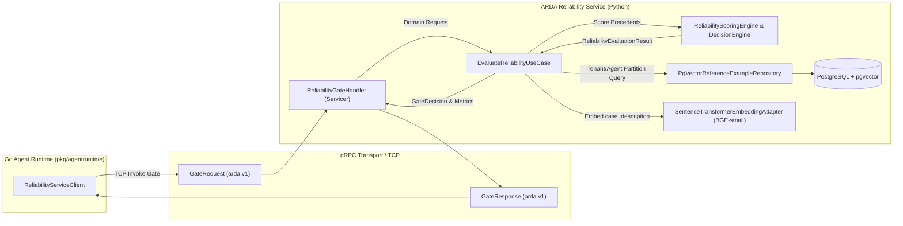

# ARDA Reliability Service — gRPC Gate Handler Design & Implementation

## 1. Overview and Objectives

The **ARDA Reliability Service** provides high-assurance reliability gating for autonomous agent executions across the ARDA platform. When an autonomous agent in the Go Agent Runtime proposes an adjudication decision (such as `APPROVE` or `REJECT` on a financial dispute), the agent runtime delegates confidence scoring and policy verification to the Reliability Service.

This milestone implements the **gRPC Gate Handler** and **Async Server**, exposing the platform gate evaluation logic via the production protobuf contract defined in `reliability.proto`.



---

## 2. Protobuf Compilation and Package Architecture

### 2.1 Contract Specification
The authoritative protobuf contract resides in `/home/aswin/second-project/arda/proto/arda/v1/reliability.proto`:

- **Package**: `arda.v1`
- **Service**: `ReliabilityService`
- **Method**: `Gate(GateRequest) returns (GateResponse)`

```protobuf
syntax = "proto3";

package arda.v1;

option go_package = "github.com/aswinsreeraj/arda/gen/go/arda/v1;ardav1";

service ReliabilityService {
  rpc Gate(GateRequest) returns (GateResponse);
}

enum GateOutcome {
  GATE_OUTCOME_UNSPECIFIED = 0;
  GATE_OUTCOME_PASS = 1;
  GATE_OUTCOME_REVIEW_REQUIRED = 2;
}

message GateRequest {
  string tenant_id = 1;
  string agent_id = 2;
  string case_description = 3;
  string proposed_decision = 4;
  double reliability_threshold = 5;
}

message GateResponse {
  double confidence = 1;
  GateOutcome outcome = 2;
  string reason_code = 3;
  repeated ReferenceNeighbor neighbors = 4;
}

message ReferenceNeighbor {
  string reference_example_id = 1;
  string label = 2;
  double similarity = 3;
}
```

### 2.2 Compilation Tooling & Package Isolation
Code generation is automated via `scripts/generate_protos.py`:
- Target destination: `src/arda_reliability_service/infrastructure/grpc/generated/arda/v1/`
- Generated artifacts:
  - `reliability_pb2.py`
  - `reliability_pb2.pyi` (typing stubs)
  - `reliability_pb2_grpc.py`
- **Dynamic Path Resolution**: `grpc_tools.protoc` generates relative package imports (`from arda.v1 import reliability_pb2`). To prevent `ModuleNotFoundError` across different runtime contexts without requiring manual environment configuration, `src/arda_reliability_service/infrastructure/grpc/generated/__init__.py` prepends the generated package directory to `sys.path` on import:

```python
_PKG_DIR = Path(__file__).resolve().parent
if str(_PKG_DIR) not in sys.path:
    sys.path.insert(0, str(_PKG_DIR))

from arda.v1 import reliability_pb2, reliability_pb2_grpc
```

---

## 3. ReliabilityGateHandler Implementation

The `ReliabilityGateHandler` implements `reliability_pb2_grpc.ReliabilityServiceServicer`.

### 3.1 Request Validation Pipeline
Incoming requests undergo strict field validation before invoking application use cases:
1. **Tenant ID**: Must be non-empty and a valid UUID v4 format. Returns `StatusCode.INVALID_ARGUMENT`.
2. **Agent ID**: Must be non-empty and a valid UUID v4 format. Returns `StatusCode.INVALID_ARGUMENT`.
3. **Case Description**: Must be non-empty and non-whitespace. Returns `StatusCode.INVALID_ARGUMENT`.
4. **Proposed Decision**: Normalized (`strip().upper()`), must be either `"APPROVE"` or `"REJECT"`. Returns `StatusCode.INVALID_ARGUMENT`.
5. **Reliability Threshold**: Must fall in $[0.0, 1.0]$. If unspecified ($0.0$), the system defaults to the configured environment threshold (`min_reliability_threshold`, default $0.50$). If out of range, returns `StatusCode.INVALID_ARGUMENT`.

### 3.2 Application Delegation and Lifecycle Management
The handler supports two modes of dependency wiring:
- **Pre-injected Use Case**: Direct injection of `EvaluateReliabilityUseCase` (for fast unit testing with mocks).
- **Session-Managed Factory**: Accepts `DatabaseManager`, `SentenceTransformerEmbeddingAdapter`, and `ScoringConfig`. For each request, an `AsyncSession` is checked out via `async with self.db_manager.session() as session:`, scoping database connections per RPC call while reusing the heavy embedding model and connection pool across requests.

### 3.3 Semantic Boundary Enforcement
In strict compliance with ARDA architecture rules:
- **Only** `case_description` is embedded into vector space via the embedding model.
- `proposed_decision`, historical labels, or gate outcomes are never embedded, preventing semantic leakage.

### 3.4 Outcome & Field Mapping

| Domain Concept (`EvaluateReliabilityUseCase`) | Protobuf Representation (`GateResponse`) | Notes |
| :--- | :--- | :--- |
| `GateDecision.PASS` | `GateOutcome.GATE_OUTCOME_PASS` (1) | Precedent evidence strongly supports autonomous execution. |
| `GateDecision.ESCALATE` | `GateOutcome.GATE_OUTCOME_REVIEW_REQUIRED` (2) | Human review required (conflicting evidence or score below threshold). |
| `ReliabilityScore.score` | `confidence` (`double`) | Composite reliability confidence score $\in [0.0, 1.0]$. |
| `EvaluationReasonCode` | `reason_code` (`string`) | Machine-readable explanation string (e.g. `RELIABILITY_THRESHOLD_MET`). |
| `list[ReferenceNeighbor]` | `repeated ReferenceNeighbor` | Neighbor precedents: ID, label (`APPROVE`/`REJECT`), and cosine similarity. |

### 3.5 Cold-Start Decision Semantics
A critical design requirement is that **cold-start partitions (e.g. newly deployed agents or new tenants with zero historical precedents) are NOT treated as gRPC RPC errors**.

- When an agent has zero precedents or fewer than `min_neighbor_count` neighbors:
  - Application returns `GateDecision.ESCALATE` with `EvaluationReasonCode.COLD_START_INSUFFICIENT_EVIDENCE` and `confidence = 0.0`.
  - gRPC handler returns HTTP 200 / gRPC `OK` with `outcome = GATE_OUTCOME_REVIEW_REQUIRED`.
  - The agent workflow pauses for human review as designed by platform governance.
  - Only protocol violations (malformed UUIDs, invalid decision values) return gRPC `INVALID_ARGUMENT`.

---

## 4. Error Mapping Reference

| Condition / Exception | gRPC Status Code | Description / Client Action |
| :--- | :--- | :--- |
| Empty / missing `tenant_id` or invalid UUID | `INVALID_ARGUMENT` (3) | Client provided an unparseable UUID for `tenant_id`. |
| Empty / missing `agent_id` or invalid UUID | `INVALID_ARGUMENT` (3) | Client provided an unparseable UUID for `agent_id`. |
| Empty or whitespace-only `case_description` | `INVALID_ARGUMENT` (3) | Client provided an empty case narrative. |
| Unrecognized `proposed_decision` (`!APPROVE` and `!REJECT`) | `INVALID_ARGUMENT` (3) | Decision must be `"APPROVE"` or `"REJECT"`. |
| `reliability_threshold` $< 0.0$ or $> 1.0$ | `INVALID_ARGUMENT` (3) | Custom override must be within valid probability range. |
| Domain validation error (`DomainValidationError`) | `INVALID_ARGUMENT` (3) | Domain invariants violated. |
| Unexpected backend error (DB pool timeout, hardware failure) | `INTERNAL` (13) | Internal error logged; request safely aborted with sanitization. |

---

## 5. Async Server Architecture & Lifecycle Management

`ReliabilityGrpcServer` manages the async server lifecycle:
- Built on `grpc.aio.server` with a dedicated `ThreadPoolExecutor`.
- Configurable maximum workers (`grpc_max_workers`), message sizes (`grpc_max_message_length_mb`), and network interface (`grpc_host`, `grpc_port`).
- **Dynamic Port Binding**: Supports `port=0`, which queries the OS kernel for an ephemeral port, stored in the `.bound_port` property. This guarantees zero port collision in concurrent CI/CD pipelines and integration test runs.
- **Graceful Shutdown**: `server.stop(grace=...)` allows in-flight RPC evaluations to finish draining before severing TCP sockets.
- **Idempotence**: Calling `stop()` repeatedly or before `start()` does not raise exceptions.
- **Process Signals**: The CLI entry point handles `SIGINT` and `SIGTERM` gracefully, triggering disposal of both the gRPC server and SQLAlchemy connection pools.

---

## 6. Go Agent Runtime Interoperability

### 6.1 Verification Architecture
The Go Agent Runtime repository at `/home/aswin/second-project/arda` consumes the generated Go protobuf package `github.com/aswinsreeraj/arda/gen/go/arda/v1`.

An automated end-to-end interoperability verification suite was implemented and verified:
- `gen/go/arda/v1/interop_test.go`: Go client integration test verifying connection, request serialization, RPC execution, response parsing, and status code handling.
- `scripts/verify_go_interop.py`: Automated orchestration script launching the Python gRPC server, seeding PostgreSQL test partitions, executing `go test`, and verifying results.

### 6.2 Go Client Code Example

```go
package main

import (
	"context"
	"fmt"
	"log"
	"time"

	ardav1 "github.com/aswinsreeraj/arda/gen/go/arda/v1"
	"google.golang.org/grpc"
	"google.golang.org/grpc/credentials/insecure"
)

func evaluateAgentDecision(ctx context.Context, serverAddr string) error {
	// 1. Establish gRPC connection to Python Reliability Service
	conn, err := grpc.NewClient(serverAddr, grpc.WithTransportCredentials(insecure.NewCredentials()))
	if err != nil {
		return fmt.Errorf("failed to dial reliability service: %w", err)
	}
	defer conn.Close()

	client := ardav1.NewReliabilityServiceClient(conn)

	// 2. Prepare Gate request from Agent Runtime
	req := &ardav1.GateRequest{
		TenantId:             "8a337c38-e7c3-4aee-a5b4-9ba0c29e904d",
		AgentId:              "d09617d3-f0a5-4e78-a89e-4a69d273a027",
		CaseDescription:      "Customer filed dispute within 20 days. Cardholder history is clean with high tenure. Low chargeback ratio and no merchant dispute flags.",
		ProposedDecision:     "APPROVE",
		ReliabilityThreshold: 0.50,
	}

	callCtx, cancel := context.WithTimeout(ctx, 5*time.Second)
	defer cancel()

	// 3. Invoke Gate RPC
	resp, err := client.Gate(callCtx, req)
	if err != nil {
		return fmt.Errorf("Gate RPC failed: %w", err)
	}

	// 4. Process Gate response
	switch resp.Outcome {
	case ardav1.GateOutcome_GATE_OUTCOME_PASS:
		log.Printf("[GATE PASS] Confidence: %.4f, Reason: %s", resp.Confidence, resp.ReasonCode)
		for i, neighbor := range resp.Neighbors {
			log.Printf("  Neighbor #%d: ID=%s Label=%s Similarity=%.4f",
				i+1, neighbor.ReferenceExampleId, neighbor.Label, neighbor.Similarity)
		}
		// Proceed with autonomous execution...

	case ardav1.GateOutcome_GATE_OUTCOME_REVIEW_REQUIRED:
		log.Printf("[GATE ESCALATE] Review required! Confidence: %.4f, Reason: %s",
			resp.Confidence, resp.ReasonCode)
		// Route case to human-in-the-loop review queue...

	default:
		log.Printf("[GATE UNKNOWN] Unexpected outcome: %v", resp.Outcome)
	}

	return nil
}
```

### 6.3 Interoperability Test Results
Running `scripts/verify_go_interop.py` validates the end-to-end integration:

```
======================================================================
ARDA RELIABILITY SERVICE: GO CLIENT INTEROPERABILITY VERIFICATION
======================================================================

[1/4] Initializing Database & SentenceTransformers embedding adapter...
[2/4] Starting ReliabilityService async gRPC server on 127.0.0.1:0...
       -> Bound successfully to 127.0.0.1:35593
[3/4] Seeding reference examples for Tenant b0288033-d833-4734-989a-a22d24430997...
       -> Seeded 4 APPROVE reference examples with embeddings.
[4/4] Executing Go client tests against 127.0.0.1:35593...
Go test output:
=== RUN   TestReliabilityGateInterop
=== RUN   TestReliabilityGateInterop/cold_start_returns_GATE_OUTCOME_REVIEW_REQUIRED
=== RUN   TestReliabilityGateInterop/seeded_evidence_returns_GATE_OUTCOME_PASS
=== RUN   TestReliabilityGateInterop/invalid_tenant_id_returns_InvalidArgument
=== RUN   TestReliabilityGateInterop/invalid_proposed_decision_returns_InvalidArgument
--- PASS: TestReliabilityGateInterop (0.08s)
    --- PASS: TestReliabilityGateInterop/cold_start_returns_GATE_OUTCOME_REVIEW_REQUIRED (0.06s)
    --- PASS: TestReliabilityGateInterop/seeded_evidence_returns_GATE_OUTCOME_PASS (0.02s)
    --- PASS: TestReliabilityGateInterop/invalid_tenant_id_returns_InvalidArgument (0.00s)
    --- PASS: TestReliabilityGateInterop/invalid_proposed_decision_returns_InvalidArgument (0.00s)
PASS
ok      github.com/aswinsreeraj/arda/gen/go/arda/v1     0.090s

SUCCESS: Go client verified against Python gRPC server!

Cleaning up seeded database records and shutting down gRPC server...
Done.
```

---

## 7. Verification and Quality Gates

### 7.1 Python Test Suite Breakdown
- **Unit Tests (`tests/test_grpc_handler.py`)**: 12 tests covering valid `APPROVE`/`REJECT` flows, custom threshold application, cold-start handling, input validation aborts (`INVALID_ARGUMENT`), and application exception handling (`INTERNAL`).
- **Server Lifecycle Tests (`tests/test_grpc_server_lifecycle.py`)**: 4 tests covering dynamic port binding (`port=0`), graceful shutdown, stop idempotence, configuration options, and factory wiring.
- **Integration Tests (`tests/test_grpc_integration.py`)**: 5 tests executing live async TCP loopback calls across database querying, embedding generation, decision evaluation, cold start, and argument errors.
- **Go Interop Tests (`gen/go/arda/v1/interop_test.go`)**: 4 tests verifying contract deserialization, status codes, and enum mappings from Go.

