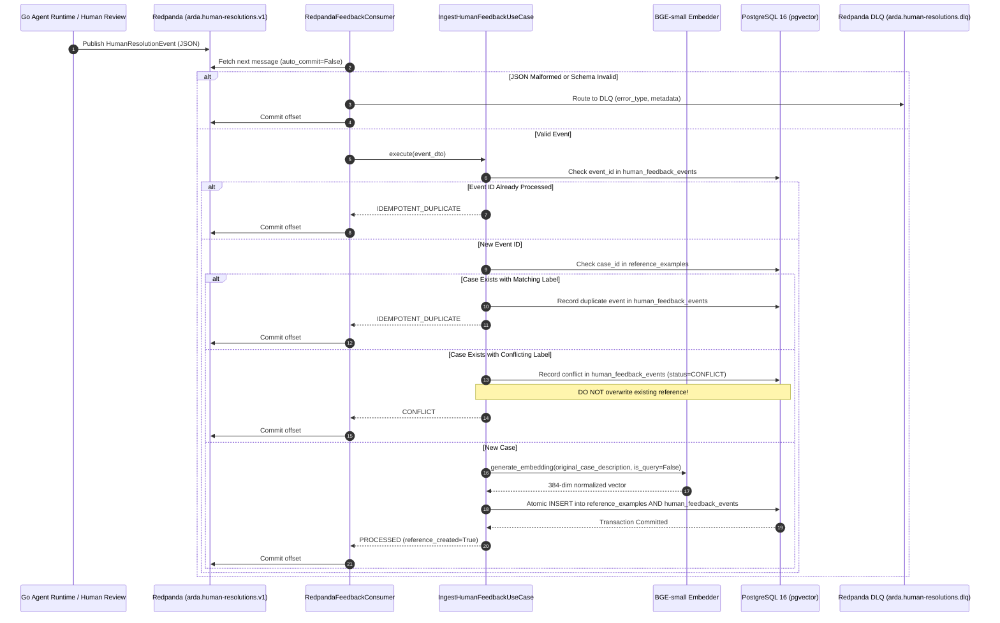

# ARDA Reliability Service — Asynchronous Human Feedback Ingestion Design

## 1. Executive Summary & Architectural Objective

The ARDA Reliability Service provides runtime reliability gating for autonomous agents executing high-stakes actions. When confidence is insufficient, decisions are escalated for human adjudication.

The **Asynchronous Human Feedback Ingestion Pipeline** closes this governance loop by streaming authoritative human resolution events from Redpanda/Kafka into the Reliability Service, generating dense semantic embeddings exclusively from the case narrative, and persisting high-integrity reference examples into PostgreSQL with pgvector.

---

## 2. Hexagonal / Clean Architecture Boundaries

The implementation strictly maintains Hexagonal Architecture boundaries:

- **Domain Layer (`domain/`)**: Defines `HumanResolutionEvent` entity, `HumanResolutionStatus` lifecycle outcomes, and domain exceptions (`EventValidationError`, `UnsupportedEventVersionError`, `UnreviewedAgentDecisionError`, `ConflictingHumanResolutionError`). It contains zero dependencies on databases, messaging brokers, or external frameworks.
- **Application Layer (`application/`)**:
  - `ports/`: Declares abstract interfaces `HumanFeedbackRepositoryPort` and `EmbeddingProviderPort`.
  - `use_cases/`: Implements `IngestHumanFeedbackUseCase`, orchestrating schema normalization, duplicate checks, conflict detection, single-passage embedding generation, and atomic persistence.
- **Infrastructure Layer (`infrastructure/`)**:
  - `messaging/`: Implements `RedpandaFeedbackConsumer` using `aiokafka`, `HumanResolutionEventDTO` validation using Pydantic, and `ConsumerMetrics`.
  - `database/`: Implements `PgHumanFeedbackRepository` and SQLAlchemy model `HumanFeedbackEventModel` with migration `0002_create_human_feedback_events_table.py`.
  - `embedding/`: Implements `SentenceTransformerEmbeddingAdapter` using `BAAI/bge-small-en-v1.5`.

---

## 3. Versioned Event Contract (`arda.human-resolutions.v1`)

### Schema Specification
```json
{
  "$schema": "https://json-schema.org/draft/2020-12/schema",
  "title": "HumanResolutionEvent",
  "type": "object",
  "properties": {
    "event_id": {
      "type": "string",
      "description": "Globally unique identifier for the event (UUID or URN)."
    },
    "event_type": {
      "type": "string",
      "const": "arda.reliability.human_resolution"
    },
    "event_version": {
      "type": "string",
      "enum": ["v1"]
    },
    "tenant_id": {
      "type": "string",
      "format": "uuid",
      "description": "UUID of tenant partition."
    },
    "agent_id": {
      "type": "string",
      "format": "uuid",
      "description": "UUID of agent partition."
    },
    "case_id": {
      "type": "string",
      "minLength": 1,
      "description": "Unique business identifier of the case / incident."
    },
    "original_case_description": {
      "type": "string",
      "minLength": 1,
      "description": "Natural language case narrative as originally presented to the agent."
    },
    "proposed_decision": {
      "type": "string",
      "enum": ["APPROVE", "REJECT"],
      "description": "The decision originally proposed by the autonomous agent."
    },
    "human_decision": {
      "type": "string",
      "enum": ["APPROVE", "REJECT"],
      "description": "The authoritative resolution decided by the human adjudicator."
    },
    "reviewer_id": {
      "type": "string",
      "minLength": 1,
      "description": "Identifier of the human reviewer (e.g. employee ID or badge)."
    },
    "resolved_at": {
      "type": "string",
      "format": "date-time",
      "description": "ISO 8601 UTC timestamp of resolution."
    },
    "correlation_id": {
      "type": "string",
      "description": "Distributed trace ID or workflow execution ID."
    }
  },
  "required": [
    "event_id",
    "event_type",
    "event_version",
    "tenant_id",
    "agent_id",
    "case_id",
    "original_case_description",
    "proposed_decision",
    "human_decision",
    "reviewer_id",
    "resolved_at"
  ]
}
```

### Producer and Consumer Responsibilities
- **Producer (Go Human Review Workflow / Gateway)**: Emits event to Redpanda topic `arda.human-resolutions.v1` only after human sign-off is completed. Sets `human_decision` strictly to `APPROVE` or `REJECT`. Never emits unreviewed or speculative events.
- **Consumer (Python Reliability Service)**: Subscribes with consumer group `arda-reliability-feedback-group`. Manually commits offsets only after atomic database commit or dead-letter queue routing.

---

## 4. End-to-End Sequence Diagram



---

## 5. Reference Example Lifecycle Rules

1. **Authoritative Human Decisions Only**: Only human adjudications (`APPROVE` or `REJECT`) can create or update reference examples. Unreviewed proposals are unconditionally rejected.
2. **Embedding Invariant**: Only `original_case_description` is passed to the embedding provider with `is_query=False`. Under no circumstances are proposed decisions, labels, rationales, reviewer identities, or evaluation results concatenated into the embedded text.
3. **Tenant & Agent Partitioning**: All queries, uniqueness constraints, and writes enforce strict scoping by `tenant_id` and `agent_id`.
4. **No Silent Overwrite / Conflict Policy**: If an authoritative resolution arrives for a `case_id` that already exists with an opposing label:
   - A `CONFLICT` audit record is stored in `human_feedback_events` capturing both labels and reviewer metadata.
   - Structured warning logs and Prometheus conflict counters are emitted.
   - The existing `reference_examples` record is preserved without silent overwrite.

---

## 6. Idempotency & Delivery Guarantees

- **Delivery Guarantee**: At-least-once delivery over Redpanda/Kafka transport.
- **Effectively-Once Processing**: Achieved via multi-tier database uniqueness:
  - `idx_human_feedback_events_event_id`: Unique index on `event_id` prevents duplicate processing attempts.
  - `uq_reference_examples_tenant_agent_example_id`: Compound unique constraint on `(tenant_id, agent_id, example_id)` guarantees single representation per case.
  - Concurrent duplicate deliveries are serialized by transaction-level row locks and unique constraint violations, gracefully returning `IDEMPOTENT_DUPLICATE`.

---

## 7. Reliability, Recovery, and Dead-Letter Queue (DLQ)

- **Manual Offset Commits**: Consumer runs with `enable_auto_commit=False`. An offset is committed if and only if the event was durably committed to PostgreSQL or successfully routed to the DLQ.
- **Transient Error Retry**: Transient database connection issues or embedding timeouts trigger bounded exponential backoff (`redpanda_max_retries=3`, `retry_backoff_base=0.5s`).
- **Poison Message Isolation**: Non-recoverable malformed JSON, schema violations, or exhausted retries are published to `arda.human-resolutions.dlq` with failure diagnostics before advancing consumer offsets.
- **Partial Failure Prevention**: Embedding generation occurs before database transaction initiation. If embedding fails, no database transaction is opened and no corrupted reference example is stored.

---

## 8. Database Migrations

### Revision `0002_create_human_feedback_events_table.py`
Creates table `human_feedback_events`:
- `id` (UUID, primary key)
- `event_id` (VARCHAR(128), unique, index)
- `event_type` (VARCHAR(128))
- `event_version` (VARCHAR(32))
- `tenant_id` (UUID, index)
- `agent_id` (UUID, index)
- `case_id` (VARCHAR(128), index)
- `human_decision` (VARCHAR(32))
- `proposed_decision` (VARCHAR(32), nullable)
- `reviewer_id` (VARCHAR(128), nullable)
- `status` (VARCHAR(32), index: `PROCESSED`, `IDEMPOTENT_DUPLICATE`, `CONFLICT`, `FAILED`)
- `conflict_details` (JSONB, nullable)
- `correlation_id` (VARCHAR(128), nullable)
- `resolved_at` (TIMESTAMPTZ)
- `created_at` (TIMESTAMPTZ)

---

## 9. Observability & Auditing

- **Thread-safe Metrics (`ConsumerMetrics`)**:
  - `events_received`: Total messages pulled from Redpanda.
  - `events_processed`: Successfully handled messages.
  - `duplicate_events`: Idempotent duplicates skipped.
  - `invalid_events`: Malformed JSON or schema rejections.
  - `processing_failures`: Transient processing exceptions.
  - `embedding_failures`: Vector generation failures.
  - `reference_examples_created`: New reference examples persisted.
  - `conflicting_resolutions`: Conflicting human adjudications detected.
  - `dead_lettered_events`: Messages routed to DLQ.
  - `avg_latency_ms`: Processing latency average.
- **Privacy & PII Protection**: Log output deliberately omits raw case descriptions, reviewer credentials, and tokens. Logs record only `event_id`, `tenant_id`, `agent_id`, `case_id`, `status`, and `latency_ms`.

---

## 10. Local Development & Verification

### Running the Services
```bash
# Start PostgreSQL (pgvector) and Redpanda
docker compose up -d postgres redpanda

# Run Alembic migrations
.venv/bin/alembic upgrade head
```

### Running Tests
```bash
# Full test suite (193 tests)
.venv/bin/pytest tests/ -v

# Human feedback ingestion tests (15 verification scenarios)
.venv/bin/pytest tests/test_human_feedback_ingestion.py -v

# Real Redpanda integration test
.venv/bin/pytest tests/test_redpanda_real_integration.py -v
```

