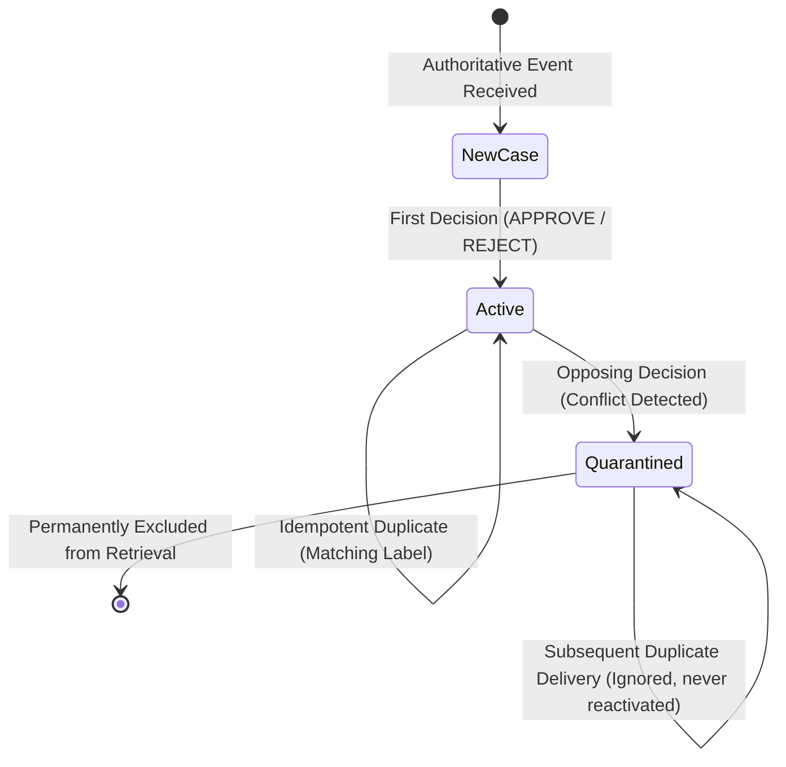
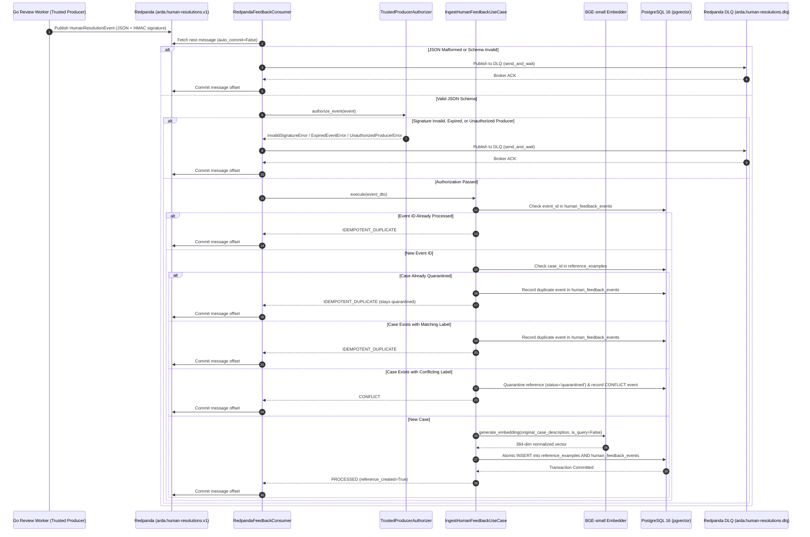

# ARDA Reliability Service — Asynchronous Human Feedback Ingestion Design

## 1. Executive Summary & Architectural Objective

The ARDA Reliability Service provides runtime reliability gating for autonomous agents executing high-stakes actions. When confidence is insufficient, decisions are escalated for human adjudication.

The **Asynchronous Human Feedback Ingestion Pipeline** closes this governance loop by streaming authoritative human resolution events from Redpanda/Kafka into the Reliability Service, generating dense semantic embeddings exclusively from the case narrative, and persisting high-integrity reference examples into PostgreSQL with pgvector.

This design incorporates **cryptographic event-signature authentication, conflict quarantine, replay defense, and safe message handling**:
- **HMAC-SHA256 Event Signature Verification**: Cryptographically binds the producer identity and secret to the canonical event contents, guaranteeing tamper-evidence for case descriptions, decisions, and tenant/agent scoping.
- **Key Rotation & Secret Isolation**: Per-producer multi-key management supporting zero-downtime rotation with zero secret exposure in payloads, logs, database tables, or DLQ diagnostics.
- **Replay Protection**: Dual-layer defense combining signed timestamp freshness checks (with configurable clock skew tolerance) and database-level idempotency enforcement.
- **Conflict Quarantine & Retrieval Exclusion**: Immediate transition of conflicting reference examples to `status = "quarantined"`, ensuring contradictory evidence cannot distort autonomous reliability evaluations.
- **DLQ Acknowledgement & Offset Safety**: Manual offset commits strictly gated on positive broker acknowledgement of DLQ publication or successful atomic database transactions.

---

## 2. Hexagonal / Clean Architecture Boundaries

The implementation strictly maintains Hexagonal Architecture boundaries:

- **Domain Layer (`domain/`)**:
  - `HumanResolutionEvent` entity with `producer_id`, `key_id`, `signature`, and signed `timestamp`.
  - `HumanResolutionStatus` lifecycle outcomes (including `QUARANTINED`).
  - Valid statuses in `ReferenceExample`: `active`, `archived`, `pending`, `quarantined`, `disputed`.
  - Domain exceptions: `UnauthorizedProducerError`, `InvalidSignatureError`, `ExpiredEventError`, `InvalidEventTimestampError`, `UnauthorizedReviewerError`, `DLQPublicationError`, `EventValidationError`, `UnsupportedEventVersionError`, `UnreviewedAgentDecisionError`, `ConflictingHumanResolutionError`.
  - Contains zero dependencies on databases, messaging brokers, or external frameworks.
- **Application Layer (`application/`)**:
  - `ports/`: Declares abstract interfaces `HumanFeedbackRepositoryPort`, `EmbeddingProviderPort`, and `EventAuthorizerPort`.
  - `use_cases/`: Implements `IngestHumanFeedbackUseCase`, orchestrating producer signature authorization, schema normalization, duplicate checks, conflict quarantine, single-passage embedding generation, and atomic persistence.
- **Infrastructure Layer (`infrastructure/`)**:
  - `messaging/`: Implements `RedpandaFeedbackConsumer` using `aiokafka`, `TrustedProducerAuthorizer` for canonical serialization, HMAC-SHA256 verification, and reviewer screening, `HumanResolutionEventDTO` validation using Pydantic, and `ConsumerMetrics`.
  - `database/`: Implements `PgHumanFeedbackRepository` and SQLAlchemy models `ReferenceExampleModel` and `HumanFeedbackEventModel` with migrations.
  - `embedding/`: Implements `SentenceTransformerEmbeddingAdapter` using `BAAI/bge-small-en-v1.5`.

---

## 3. Cryptographic Producer Authentication & Event-Signing Contract

### 3.1 Previous Authentication Weakness vs. Current Implementation
- **Previous Weakness**: The initial implementation performed `hmac.compare_digest(producer_token, secret)`. While timing-safe, this only verified a static shared secret string. It did **not** compute a cryptographic hash over the event payload, leaving the event vulnerable to tampering (e.g. altering the tenant, agent, case description, or decision after signing).
- **Hardened Implementation**: The authorizer computes an **HMAC-SHA256 signature over a deterministic canonical representation** of the event fields. The signature is bound to the exact payload contents, guaranteeing integrity and non-repudiation across the producer boundary. `hmac.compare_digest` is used exclusively for comparing the calculated and supplied signatures.

### 3.2 Canonical Serialization Rules
To guarantee identical byte-level serialization between heterogeneous environments (Python Reliability Service vs. Go Review Worker), canonicalization enforces the following contract:

1. **Included Fields (13 fields, strictly sorted lexicographically)**:
   - `agent_id`: string (UUID formatted as lowercase with hyphens, e.g. `365454fd-fd14-4753-af0e-bbbd7288356b`)
   - `case_id`: string (trimmed)
   - `event_id`: string (trimmed)
   - `event_type`: string (trimmed, e.g. `arda.reliability.human_resolution`)
   - `event_version`: string (trimmed, `v1`)
   - `human_decision`: string (uppercase trimmed, `APPROVE` or `REJECT`)
   - `key_id`: string (trimmed, e.g. `v1`, `v2`)
   - `original_case_description`: string (exact case text as presented to agent)
   - `producer_id`: string (trimmed, e.g. `arda.human-review-service`)
   - `proposed_decision`: string (uppercase trimmed, `APPROVE` or `REJECT`)
   - `reviewer_id`: string (trimmed)
   - `tenant_id`: string (UUID formatted as lowercase with hyphens)
   - `timestamp`: string (canonical RFC3339 UTC string with second precision: `YYYY-MM-DDTHH:MM:SSZ`)

2. **Excluded Fields**:
   - `signature` / `producer_token` (cannot sign the signature itself)
   - `correlation_id` (distributed tracing metadata that may be mutated by service proxies/sidecars)
   - Transport metadata (Kafka partition, offset, topic, arrival timestamps)

3. **Serialization Format**:
   - Compact UTF-8 encoded JSON with no whitespace: `json.dumps(dict, sort_keys=True, separators=(',', ':')).encode('utf-8')`.

### 3.3 Go Producer Signing Example
When the Go Agent Runtime human review worker publishes an authoritative resolution, it must generate the signature as follows:

```go
package producer

import (
	"crypto/hmac"
	"crypto/sha256"
	"encoding/hex"
	"encoding/json"
	"time"
)

type CanonicalPayload struct {
	AgentID                 string `json:"agent_id"`
	CaseID                  string `json:"case_id"`
	EventID                 string `json:"event_id"`
	EventType               string `json:"event_type"`
	EventVersion            string `json:"event_version"`
	HumanDecision           string `json:"human_decision"`
	KeyID                   string `json:"key_id"`
	OriginalCaseDescription string `json:"original_case_description"`
	ProducerID              string `json:"producer_id"`
	ProposedDecision        string `json:"proposed_decision"`
	ReviewerID              string `json:"reviewer_id"`
	TenantID                string `json:"tenant_id"`
	Timestamp               string `json:"timestamp"`
}

func SignEvent(payload CanonicalPayload, secretKey string) (string, error) {
	// 1. Serialize deterministic JSON (compact, sorted keys)
	payloadBytes, err := json.Marshal(payload)
	if err != nil {
		return "", err
	}

	// 2. Compute HMAC-SHA256
	mac := hmac.New(sha256.New, []byte(secretKey))
	mac.Write(payloadBytes)
	
	// 3. Return hex-encoded signature
	return hex.EncodeToString(mac.Sum(nil)), nil
}
```

### 3.4 Key Identifier & Rotation Strategy
- Configuration defines a mapping of `producer_id -> {key_id: secret}` (`redpanda_producer_secrets`).
- To rotate a secret:
  1. Add the new key (e.g. `v2`) to the Reliability Service configuration alongside `v1`.
  2. Update the producer to sign using `key_id="v2"` and the new secret.
  3. Verify traffic flows successfully under `v2`.
  4. Decommission `v1` from configuration.
- Unknown producer IDs and unknown key IDs raise `UnauthorizedProducerError` and are routed to DLQ.

### 3.5 Secret Management & Zero-Leakage Invariant
- Signing secrets are **never** included in event payloads.
- Secrets are **never** persisted in PostgreSQL database tables.
- Secrets are **never** rendered in application logs, error messages, or Dead-Letter Queue diagnostic payloads.

---

## 4. Replay Protection and Freshness

Replay protection is enforced via a two-tier mechanism:

1. **Windowed Freshness Check (Signature Level)**:
   - Every event includes a signed `timestamp` (formatted as RFC3339 UTC).
   - Ingestion calculates `age = now - event_timestamp`.
   - If `age > redpanda_max_event_age_seconds` (default: 300s / 5 minutes), the event is rejected with `ExpiredEventError`.
   - If `age < -redpanda_clock_skew_tolerance_seconds` (default: 60s in the future), the event is rejected with `InvalidEventTimestampError`.
   - Because the timestamp is part of the canonical payload, tampering with the timestamp invalidates the HMAC signature.
2. **Database Idempotency Enforcement (Persistence Level)**:
   - For replays occurring within the 300s window, the repository enforces idempotency:
     - `idx_human_feedback_events_event_id`: Unique constraint on `event_id`.
     - `uq_reference_examples_tenant_agent_example_id`: Compound unique constraint on `(tenant_id, agent_id, example_id)`.
   - Replayed events return `IDEMPOTENT_DUPLICATE` and cannot duplicate reference examples or alter state.

---

## 5. Reviewer Authorization Boundary & Gap Analysis

```
+-------------------------------------------------------+
| Upstream Trusted Producer Boundary                    |
| (Go Gateway / Temporal Review Worker)                 |
|   - Authenticates reviewer session (Auth0 / OIDC)     |
|   - Evaluates RBAC (RoleReviewer) & tenant membership |
|   - Computes HMAC-SHA256 signature using producer key |
+---------------------------+---------------------------+
                            |
             Redpanda: arda.human-resolutions.v1
                            |
+---------------------------v---------------------------+
| Reliability Service Ingress                           |
| (TrustedProducerAuthorizer)                           |
|   1. Whitelist verification (producer_id in trusted)  |
|   2. Key lookup (key_id in producer_keys)             |
|   3. Freshness check (age <= 300s, skew <= 60s)       |
|   4. HMAC-SHA256 verification (canonical payload)     |
|   5. Reviewer heuristic screening (reject bot/anon)   |
+-------------------------------------------------------+
```

### Delegation Contract:
- The Reliability Service **delegates reviewer tenant-membership RBAC to the upstream producer boundary**.
- **Reason**: No centralized reviewer-directory network RPC currently exists to query user-to-tenant memberships asynchronously from Python.
- **Reviewer Screening**: The Python service screens `reviewer_id` against bot and forged patterns (`anonymous`, `unauthorized`, `bot`, `system`, `automated`, `unknown`, `none`). This screening provides defensive sanity checking but is **not** equivalent to external directory RBAC.
- **Integration Dependency**: Upstream Go event publishers must guarantee human identity authentication and tenant isolation prior to signing and emitting events.

---

## 6. Conflict Resolution & Quarantine State Machine



### Conflict Handling Guarantees:
1. **Immediate Quarantine**: When a case previously resolved with `APPROVE` receives `REJECT` (or vice-versa), `reference_examples.status` is transitioned to `"quarantined"`.
2. **Preserved History**: The existing reference example’s label is preserved without silent overwrite. Conflict diagnostics (`existing_label`, `new_label`, `reviewer_id`, `quarantined_at`, `reason`) are stored in `metadata_`.
3. **Audit Trail Completeness**: Both the original event and conflicting resolution are persisted in `human_feedback_events` (`status='PROCESSED'` and `status='CONFLICT'`).
4. **Retrieval Exclusion**: In `PgVectorReferenceExampleRepository`, exact and HNSW cosine retrieval queries strictly filter on `WHERE status = 'active'`. Quarantined examples are completely invisible to vector search and cannot contribute evidence to agent reliability evaluations.
5. **Reactivation Prevention**: Subsequent duplicate deliveries of either label check `existing_reference.status in {'quarantined', 'disputed'}` and immediately return `IDEMPOTENT_DUPLICATE` without reactivating the reference to `active`.
6. **Concurrent Race Protection**: PostgreSQL's `ON CONFLICT DO NOTHING` on `(tenant_id, agent_id, example_id)` serializes concurrent inserts. If an insert yields `rowcount == 0`, the transaction queries the committed row; if labels oppose, it executes `record_conflict()`, guaranteeing that the case enters `quarantined` state without deadlock or split-brain.

---

## 7. End-to-End Sequence Diagram



---

## 8. Kafka Offset Safety & DLQ Reliability Guarantees

1. **Broker Acknowledged DLQ Delivery**:
   - `_send_to_dlq` synchronously awaits broker acknowledgement via `await producer.send_and_wait(...)`.
   - If DLQ publication succeeds, `process_single_message` returns `True`, allowing `_commit_message_offset` to run.
   - If DLQ publication fails (e.g. broker timeout), `process_single_message` returns `False`, and the original message offset is **NEVER** committed.
2. **Crash Recovery & Idempotency on Redelivery**:
   - If the consumer crashes after writing to DLQ but before committing the offset, the broker redelivers the message upon restart.
   - The redelivered poison message is routed to DLQ again and acknowledged, safely advancing the offset without data loss or pipeline stalling.
3. **Sequential Partition Processing**:
   - Partitions are consumed sequentially per worker loop iteration. Offsets are committed monotonically in strict message order, preventing offset skipping.
4. **Graceful Shutdown Invariant**:
   - When cancellation occurs during consumer shutdown, in-flight processing tasks are cancelled before `_commit_message_offset` is invoked. Unfinished messages remain uncommitted and are safely resumed on subsequent restart.

---

## 9. Verification & Quality Gates

```bash
# Run complete test suite (216 tests)
.venv/bin/pytest tests/ -v

# Run the 23 security, HMAC verification, and conflict hardening tests
.venv/bin/pytest tests/test_human_feedback_security_and_conflict.py -v

# Code quality checks
.venv/bin/ruff check src tests scripts research
.venv/bin/ruff format --check src tests scripts research
.venv/bin/mypy src tests

# Go interoperability tests
cd /home/aswin/second-project/arda && go test ./...
```
