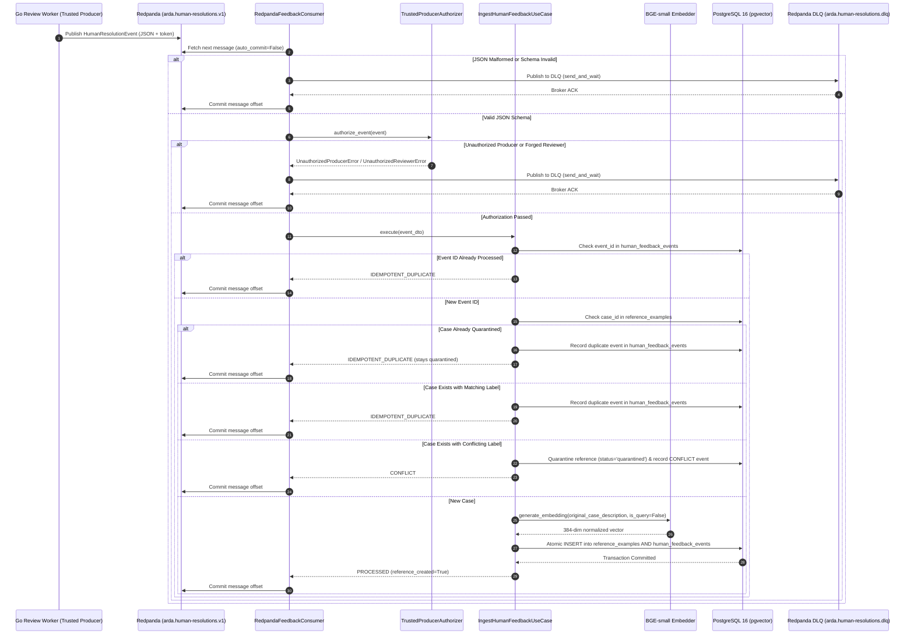

# ARDA Reliability Service — Asynchronous Human Feedback Ingestion Design

## 1. Executive Summary & Architectural Objective

The ARDA Reliability Service provides runtime reliability gating for autonomous agents executing high-stakes actions. When confidence is insufficient, decisions are escalated for human adjudication.

The **Asynchronous Human Feedback Ingestion Pipeline** closes this governance loop by streaming authoritative human resolution events from Redpanda/Kafka into the Reliability Service, generating dense semantic embeddings exclusively from the case narrative, and persisting high-integrity reference examples into PostgreSQL with pgvector.

This design incorporates **security authentication, conflict quarantine, and safe message handling hardening**:
- Cryptographic authentication of event producers and reviewer identity screening.
- Immediate quarantine of conflicting reference examples to prevent corrupted historical evidence from skewing agent reliability scoring.
- Synchronous dead-letter queue (DLQ) acknowledgement before committing Kafka offsets to ensure zero message loss.

---

## 2. Hexagonal / Clean Architecture Boundaries

The implementation strictly maintains Hexagonal Architecture boundaries:

- **Domain Layer (`domain/`)**:
  - `HumanResolutionEvent` entity with `producer_id` and `producer_token`.
  - `HumanResolutionStatus` lifecycle outcomes (including `QUARANTINED`).
  - Valid statuses in `ReferenceExample`: `active`, `archived`, `pending`, `quarantined`, `disputed`.
  - Domain exceptions: `UnauthorizedProducerError`, `UnauthorizedReviewerError`, `DLQPublicationError`, `EventValidationError`, `UnsupportedEventVersionError`, `UnreviewedAgentDecisionError`, `ConflictingHumanResolutionError`.
  - Contains zero dependencies on databases, messaging brokers, or external frameworks.
- **Application Layer (`application/`)**:
  - `ports/`: Declares abstract interfaces `HumanFeedbackRepositoryPort`, `EmbeddingProviderPort`, and `EventAuthorizerPort`.
  - `use_cases/`: Implements `IngestHumanFeedbackUseCase`, orchestrating producer/reviewer authorization, schema normalization, duplicate checks, conflict quarantine, single-passage embedding generation, and atomic persistence.
- **Infrastructure Layer (`infrastructure/`)**:
  - `messaging/`: Implements `RedpandaFeedbackConsumer` using `aiokafka`, `TrustedProducerAuthorizer` for HMAC verification and reviewer screening, `HumanResolutionEventDTO` validation using Pydantic, and `ConsumerMetrics`.
  - `database/`: Implements `PgHumanFeedbackRepository` and SQLAlchemy models `ReferenceExampleModel` and `HumanFeedbackEventModel` with migrations.
  - `embedding/`: Implements `SentenceTransformerEmbeddingAdapter` using `BAAI/bge-small-en-v1.5`.

---

## 3. Trusted Producer Authentication & Reviewer Authorization Boundary

```
+------------------------------------+          +-----------------------------------------+
| Upstream Review Service / Gateway  |          |       Reliability Service Ingress       |
|                                    |          |                                         |
| [Human Reviewer Session]           |          | [TrustedProducerAuthorizer]             |
|   - Authenticates reviewer         |          |   1. Whitelist: producer_id in Set      |
|   - Evaluates RBAC (RoleReviewer)  |          |   2. Crypto: HMAC timing-safe compare   |
|   - Signs event with shared secret |          |   3. Screen: reject bot/forged patterns |
|                                    |          |                                         |
+-----------------+------------------+          +--------------------+--------------------+
                  |                                                  |
                  +---- Redpanda Event (with producer_token) --------+
```

### 3.1 Producer Authentication
- **Producer Whitelist**: The consumer verifies `producer_id` against configured trusted services (`redpanda_trusted_producers` default: `arda.human-review-service`, `arda.gateway.review-worker`, `arda.workflow-engine`).
- **Cryptographic Token Verification**: The authorizer verifies `producer_token` against `redpanda_producer_secret` using constant-time `hmac.compare_digest` to prevent timing attacks.
- **Enforcement Toggle**: Controlled via `redpanda_enforce_producer_auth` (enabled by default).

### 3.2 Reviewer Authorization & Identity Screening
- **Screening Rules**: Events with missing, empty, or whitespace `reviewer_id` are rejected immediately.
- **Bot / Forgery Defense**: Reviewer identities matching forbidden patterns (e.g. `anonymous`, `unauthorized`, `bot`, `system`, `automated`, `unknown`, `none`) are rejected with `UnauthorizedReviewerError` and routed to DLQ.
- **External Reviewer-Directory Dependency (Boundary Delegation)**:
  - The Go Agent Runtime gateway enforces role-based access control (`RoleReviewer`) when human adjudicators submit reviews.
  - Because no external reviewer-directory network RPC exists for asynchronous cross-service tenant membership validation, the Reliability Service delegates reviewer tenant-membership RBAC to the upstream producer boundary.
  - Upstream review workers must authenticate human reviewers and guarantee tenant alignment before publishing events with valid producer credentials.

---

## 4. Versioned Event Contract (`arda.human-resolutions.v1`)

### Schema Specification
```json
{
  "$schema": "https://json-schema.org/draft/2020-12/schema",
  "title": "HumanResolutionEvent",
  "type": "object",
  "properties": {
    "event_id": {
      "type": "string",
      "description": "Globally unique identifier for the event (UUID or URN)."
    },
    "event_type": {
      "type": "string",
      "const": "arda.reliability.human_resolution"
    },
    "event_version": {
      "type": "string",
      "enum": ["v1"]
    },
    "tenant_id": {
      "type": "string",
      "format": "uuid",
      "description": "UUID of tenant partition."
    },
    "agent_id": {
      "type": "string",
      "format": "uuid",
      "description": "UUID of agent partition."
    },
    "case_id": {
      "type": "string",
      "minLength": 1,
      "description": "Unique business identifier of the case / incident."
    },
    "original_case_description": {
      "type": "string",
      "minLength": 1,
      "description": "Natural language case narrative as originally presented to the agent."
    },
    "proposed_decision": {
      "type": "string",
      "enum": ["APPROVE", "REJECT"],
      "description": "The decision originally proposed by the autonomous agent."
    },
    "human_decision": {
      "type": "string",
      "enum": ["APPROVE", "REJECT"],
      "description": "The authoritative resolution decided by the human adjudicator."
    },
    "reviewer_id": {
      "type": "string",
      "minLength": 1,
      "description": "Identifier of the human reviewer (e.g. employee ID or badge)."
    },
    "producer_id": {
      "type": "string",
      "description": "Identifier of the publishing producer service."
    },
    "producer_token": {
      "type": "string",
      "description": "Authentication token proving authorized producer boundary."
    },
    "resolved_at": {
      "type": "string",
      "format": "date-time",
      "description": "ISO 8601 UTC timestamp of resolution."
    },
    "correlation_id": {
      "type": "string",
      "description": "Distributed trace ID or workflow execution ID."
    }
  },
  "required": [
    "event_id",
    "event_type",
    "event_version",
    "tenant_id",
    "agent_id",
    "case_id",
    "original_case_description",
    "proposed_decision",
    "human_decision",
    "reviewer_id",
    "resolved_at"
  ]
}
```

---

## 5. Conflict Quarantine & Reference Lifecycle State Machine


### 5.1 Conflict Quarantine Guarantees
1. **Immediate Quarantine**: When a case previously resolved with `APPROVE` receives `REJECT` (or vice-versa), `reference_examples.status` is atomically transitioned to `"quarantined"`.
2. **Metadata Audit Preservation**: The conflicting adjudication details (`existing_label`, `new_label`, `reviewer_id`, `quarantined_at`, `reason`) are merged into the reference's `metadata` JSONB column.
3. **Audit Trail Completeness**: Both the original event and the conflicting resolution event are preserved in `human_feedback_events` (`status='PROCESSED'` and `status='CONFLICT'`).
4. **Retrieval Exclusion**: In `PgVectorReferenceExampleRepository`, exact and HNSW cosine retrieval queries enforce `WHERE status = 'active'`. Quarantined examples are completely invisible to vector search and cannot contribute evidence to agent reliability evaluations.
5. **Reactivation Prevention**: Subsequent deliveries of duplicate events (either matching the initial label or the opposing label) check `existing_reference.status in {'quarantined', 'disputed'}` and immediately return `IDEMPOTENT_DUPLICATE` without reactivating the reference to `active`.
6. **Concurrent Race Protection**: If two opposing events race into the database concurrently, PostgreSQL's `ON CONFLICT DO NOTHING` on `(tenant_id, agent_id, example_id)` allows one insert to succeed while the second transaction detects `rowcount == 0`, identifies the opposing label on the newly committed row, and executes `record_conflict()`, ensuring safe quarantine without split-brain.

---

## 6. End-to-End Sequence Diagram



---

## 7. Kafka Offset Safety & DLQ Reliability Guarantees

1. **Broker Acknowledged DLQ Delivery**:
   - `_send_to_dlq` synchronously awaits broker acknowledgement via `await producer.send_and_wait(...)`.
   - If DLQ publication succeeds, `process_single_message` returns `True`, allowing `_commit_message_offset` to run.
   - If DLQ publication fails (e.g. broker timeout), `process_single_message` returns `False`, and the original message offset is **NEVER** committed.
2. **Crash Recovery & Idempotency on Redelivery**:
   - If the consumer crashes after writing to DLQ but before committing the offset, the broker redelivers the message upon restart.
   - The redelivered poison message is routed to DLQ again and acknowledged, safely advancing the offset without data loss or pipeline stalling.
3. **Sequential Partition Processing**:
   - Partitions are consumed sequentially per worker loop iteration. Offsets are committed monotonically in strict message order, preventing offset skipping.
4. **Graceful Shutdown Invariant**:
   - When cancellation occurs during consumer shutdown, in-flight processing tasks are cancelled before `_commit_message_offset` is invoked. Unfinished messages remain uncommitted and are safely resumed on subsequent restart.

---

## 8. Database Migrations

### Revision `0002_create_human_feedback_events_table.py`
Creates table `human_feedback_events`:
- `id` (UUID, primary key)
- `event_id` (VARCHAR(128), unique, index)
- `event_type` (VARCHAR(128))
- `event_version` (VARCHAR(32))
- `tenant_id` (UUID, index)
- `agent_id` (UUID, index)
- `case_id` (VARCHAR(128), index)
- `human_decision` (VARCHAR(32))
- `proposed_decision` (VARCHAR(32), nullable)
- `reviewer_id` (VARCHAR(128), nullable)
- `status` (VARCHAR(32), index: `PROCESSED`, `IDEMPOTENT_DUPLICATE`, `CONFLICT`, `FAILED`)
- `conflict_details` (JSONB, nullable)
- `correlation_id` (VARCHAR(128), nullable)
- `resolved_at` (TIMESTAMPTZ)
- `created_at` (TIMESTAMPTZ)

---

## 9. Observability & Auditing

- **Thread-safe Metrics (`ConsumerMetrics`)**:
  - `events_received`: Total messages pulled from Redpanda.
  - `events_processed`: Successfully handled messages.
  - `duplicate_events`: Idempotent duplicates skipped.
  - `invalid_events`: Malformed JSON or authorization rejections.
  - `processing_failures`: Transient processing exceptions.
  - `embedding_failures`: Vector generation failures.
  - `reference_examples_created`: New reference examples persisted.
  - `conflicting_resolutions`: Conflicting human adjudications quarantined.
  - `dead_lettered_events`: Messages successfully routed to DLQ.
  - `avg_latency_ms`: Processing latency average.
- **Privacy & PII Protection**: Log output deliberately omits raw case descriptions, reviewer credentials, and tokens. Logs record only `event_id`, `tenant_id`, `agent_id`, `case_id`, `status`, and `latency_ms`.

---

## 10. Verification & Quality Gates

```bash
# Run complete test suite (208 tests)
.venv/bin/pytest tests/ -v

# Run the 15 security and conflict hardening scenarios
.venv/bin/pytest tests/test_human_feedback_security_and_conflict.py -v

# Code quality checks
.venv/bin/ruff check src tests scripts research
.venv/bin/ruff format --check src tests scripts research
.venv/bin/mypy src tests

# Go interoperability tests
cd /home/aswin/second-project/arda && go test ./...
```
